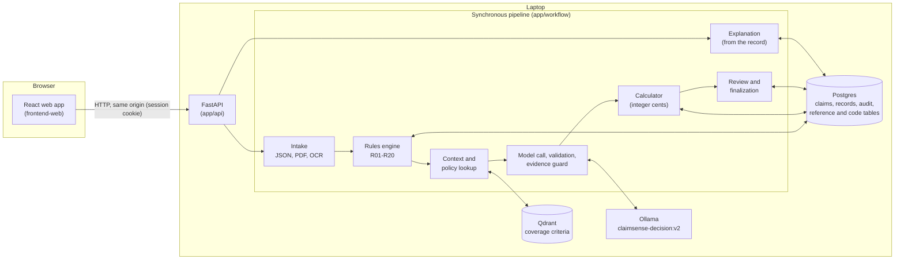

# ClaimSense

ClaimSense is a prototype of health-insurance claim processing for professional claims (the
CMS-1500 kind). A claim comes in as JSON, a PDF of our form or a scanned form; deterministic rules
check it; for the claims that pass, a small language model fine-tuned for the task recommends a
decision for each service line against the plan's coverage criteria, quoting the clinical note;
a deterministic calculator works out the amounts; and a person reviews every recommendation before
the claim is final. Every decision is explained from its decision record and kept in an audit
trail.

**Synthetic data only. Not for real claims.**

## How a claim moves

1. **Intake** reads the claim: JSON as is, a digital PDF from its boxes, a scanned form by OCR, each
   field with a confidence.
2. **Rules** (R01-R20, duplicates) reject a claim with bad data, deny or pend lines on hard
   requirements (eligibility, filing window, network, authorization, NCCI, MUE, LCD and billing
   article limits). A rule that fails on a low-confidence field rejects, never denies.
3. **Policy lookup** finds the coverage criteria for each remaining line's code, plan and date.
4. **The model** (`claimsense-decision:v2`, a fine-tuned Gemma 4 E2B served by Ollama on the laptop)
   marks each criterion met, not met, not documented or not applicable, with a quote from the note.
   The line decision is derived from those statuses by code; a quote not found in the note counts
   as not documented. The model never produces an amount.
5. **The calculator** applies the fee schedule, deductible, copay, coinsurance, out-of-pocket maximum
   and coordination of benefits, in integer cents.
6. **Review**: every model recommendation goes to a reviewer, in a quick, standard or full tier. The
   reviewer accepts it or overrides a line with a required reason; finalizing recomputes the
   amounts and updates the member's accumulators.
7. **Explanation and audit**: the explanation shows every rule check, criterion, quote, policy
   citation, amount, review action and version from the decision record, with the standard
   CARC/RARC codes on denied and rejected lines.

## Architecture

The rules and the calculator never import the model or retrieval code (import contracts). The web
app talks only to the API.

## Run it

- First time on a machine: [SETUP.md](SETUP.md) (Part I runs the demo from a fresh clone).
- The demo: `make demo-reset`, then `make demo-up` (or `make demo` for the dev server), then
  `make demo-check`, and open http://localhost:8000 and log in. The logins and the run-sheet for
  the nine demo claims are in [docs/DEMO.md](docs/DEMO.md); the passwords are in `.env`.
- Checks: `uv run pytest`, `make e2e-api` (the whole stack through the API, right after a reset),
  `make model-check` (the demo model is the one evaluated), `make web-check`, `make results`
  (regenerates [docs/results.md](docs/results.md)).

## Roles

Everyone logs in with a username and password (prototype). A **provider** files and processes
claims and sees only the claims they filed, with the decision once it is final. A **reviewer**
reviews every model recommendation. An **admin** reads everything and changes nothing. A
**member** (a patient) sees only the claims in which they are the patient, each decided claim's
explanation of benefits, their benefits this year and their profile, and cannot act on anything
(D-AUTH-1, D-MEM-1).

## Where things are

| Path | What |
|---|---|
| `app/` | intake, rules, context, model client, calculator, review, explanation, API |
| `frontend-web/` | React web app (Vite, TypeScript, shadcn/ui); design in `DESIGN.md` |
| `training/` | synthetic data generators, fine-tuning and evaluation |
| `data/curated/` | plans, benefits, coverage policies, reason-code map (fictional values; sources cited) |
| `tests/golden/` | golden rules, calculator and end-to-end cases |
| `demo/claims/` | one synthetic claim per demo path |
| `docs/` | results, training, OCR, data cards, the demo runbook |
| `DECISIONS.md`, `INSTRUCTIONS.md` | every decision and the specification |

## Limitations

- **Synthetic data only.** Members, providers, plans, claims and clinical notes are generated;
  plan and benefit values are fictional. Codes and coverage criteria come from public CMS sources
  and are paraphrased; AMA CPT descriptor text is never shown. Not for real claims.
- **Simple username and password login; no SSO, MFA, password reset or account lockout;
  prototype.** Providers see only the claims they filed, reviewers review, an admin reads
  everything (D-AUTH-1).
- **Model accuracy is below its target.** On 300 synthetic test claims, `claimsense-decision:v2`
  reaches a line-decision macro-F1 of 0.853 (0.849 with the evidence guard the pipeline uses)
  against a target of 0.90; it never denied a line that should have been paid (DENY precision
  1.000), and its errors lean towards approving or asking for more information. Every
  recommendation therefore goes to a person. Details: [docs/results.md](docs/results.md),
  [docs/results-v2-errors.md](docs/results-v2-errors.md).
- **OCR reads only our own synthetic form layout**, not the official printed CMS-1500. Field
  accuracy on held-out synthetic scans is 93.8%; a handwritten 1 is often read as 7. A field read
  with low confidence rejects the claim for resubmission rather than deciding it.
- **Long notes on further pages are found by our own page title.** A claim form has 2 pages, or up
  to 5 when its notes go on to attachment pages titled "(CONTINUED, PAGE n OF m)", which real
  attachments will not always have (D-DOC-3). The decision model v3 was trained on prompts of up
  to 4,416 tokens; a claim of 4 or 5 pages can have a longer prompt (up to the 6,656 tokens the
  model reads with its answer, checked at upload), and such prompts are untested.
- **Coverage policies cover only some services** (17 policies for the procedure codes in scope);
  a line outside them is decided on the rules and benefits alone.
- **One laptop, synchronous.** The pipeline runs claim by claim; model answers take a few seconds
  to a minute; there is no queue, no scaling and no claim history beyond the demo database.
- **Reviewer agreement and review time are not measured**: no real reviewers have used it.
