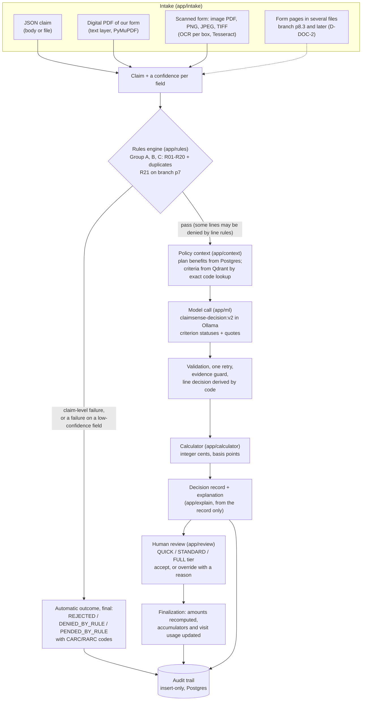
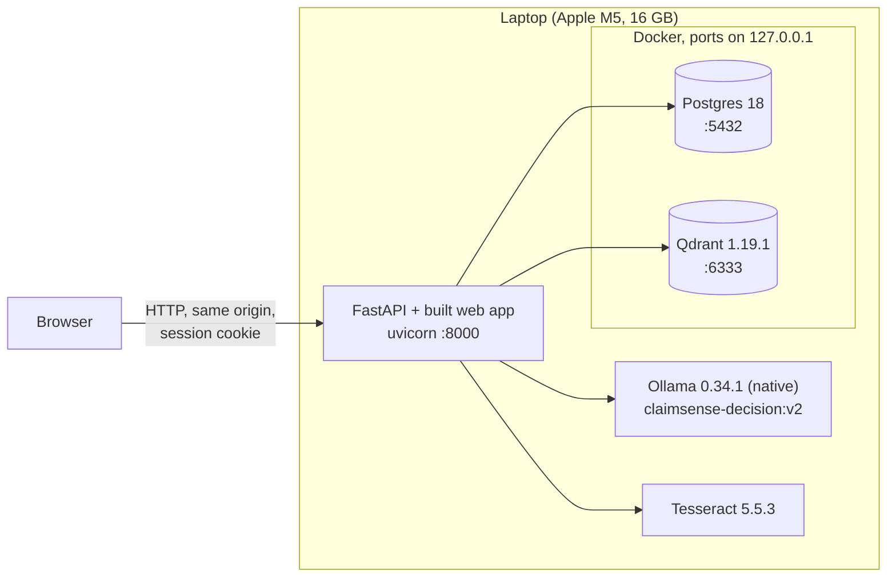
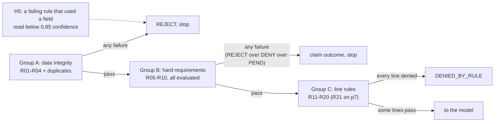
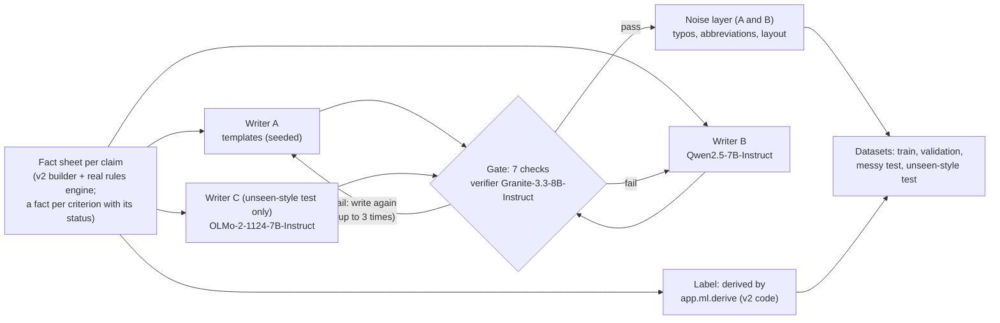
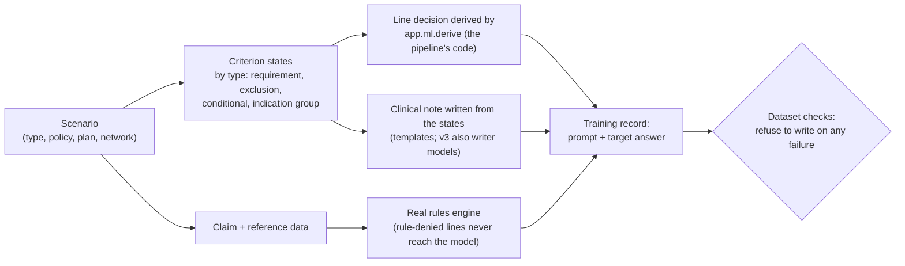
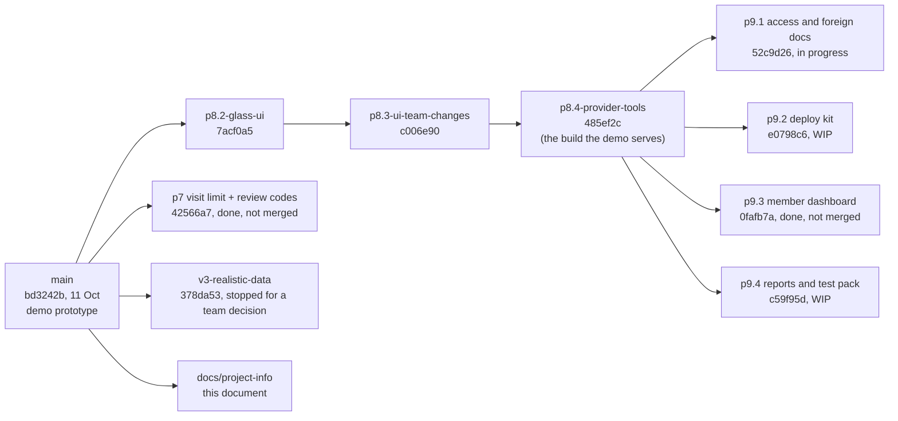

# ClaimSense: project information and progress

**As of: Friday 23 October 2026, 17:40 IST.** Written on branch `docs/project-info`, which starts
from `main` at `bd3242b` (11 Oct). This is a working information and progress document, **not the
final report**.

> **Synthetic data only.** Every member, provider, plan, claim and clinical note in ClaimSense is
> generated. Plan and benefit values are fictional. Codes and coverage criteria come from public
> CMS sources and are paraphrased. No real patient data, no AMA CPT descriptor text and no material
> from the Evernorth documents appear in the project or in this document.

**How to read this document**

- Every fact is marked with where it lives:
  - **main**: merged into `main` (`bd3242b`, 11 Oct);
  - **branch `name`**: pushed to GitHub but not merged;
  - **planned**: not built yet.
- Every number names its source next to the table: a results file, a log, a `DECISIONS.md` ID, or
  a measurement made for this document.
- Measurements made for this document (23 Oct) use the scripts in `scripts/project_info/` on this
  branch. Their outputs are in `data/generated/project_info/`, which git ignores (as all of
  `data/generated/`). Section 12 lists the commands.
- "Not measured" means no source exists. The only estimate is section 7.4, and it is labelled.
- Paths under `data/generated/` are in the primary checkout (`ClaimSense/`) unless the v3
  worktree (`claimsense-v3/`) or this branch's `data/generated/project_info/` is named.

## Contents

1. [Overview](#1-overview)
2. [Architecture](#2-architecture)
3. [Rules engine](#3-rules-engine)
4. [Models](#4-models)
5. [Datasets](#5-datasets)
6. [Evaluation method](#6-evaluation-method)
7. [Results](#7-results)
8. [Safety and privacy](#8-safety-and-privacy)
9. [Progress status](#9-progress-status)
10. [Known limitations and future work](#10-known-limitations-and-future-work)
11. [Decision log index](#11-decision-log-index)
12. [How the fresh numbers were made](#12-how-the-fresh-numbers-were-made)

---

## 1. Overview

### The problem

A health plan checks every professional claim (the CMS-1500 kind) before it pays. Part of the check
is mechanical: is the member covered on that date, is the code valid, was the claim filed in time,
is the provider in the network, is prior authorization on file, do coding edits allow the codes
together. The other part needs judgement: does the clinical note show that the service meets the
plan's coverage criteria? A person usually reads the note against the policy. That is slow. Full
automation is risky, because a wrong denial harms a patient.

### What ClaimSense does

ClaimSense is a working prototype of a claim pipeline that splits the two parts.

1. **Intake** reads the claim: JSON, a PDF of our form, or a scanned form (OCR), with a confidence
   for each field.
2. **Deterministic rules** check the hard requirements and decide on their own: reject, deny or
   pend. They never call the model.
3. For each line that passes, a **small language model** (SLM, a fine-tuned Gemma 4 E2B served
   locally by Ollama) marks each coverage criterion as met, not met, not documented or not
   applicable, and quotes the note.
4. **Code derives the line decision** from those statuses. The model never produces an amount.
5. A **deterministic calculator** works out the amounts in integer cents.
6. **A person reviews every model recommendation** before the claim is final.
7. Every decision is **explained from its decision record** and kept in an **audit trail**.

### Roles

| Role | What the role does | Where |
|---|---|---|
| Provider | Files claims (JSON or a form file) and processes them; sees only the claims it filed; sees a model-decided claim's outcome only once a reviewer has finalized it | main (D-AUTH-1) |
| Reviewer | Works the review queue (quick, standard and full tiers); accepts, or overrides a line with a required reason; reads every claim, its explanation and audit trail | main (D-AUTH-1) |
| Admin | Read only: claims, queue, audit, plans, model metrics, system status; cannot file or review | main (D-AUTH-1) |
| Member (patient) | Read only: own claims, the explanation of benefits, benefits used, profile | **branch `p9.3-member-dashboard` only, not merged** (D-MEM-1 to D-MEM-3, pending the team's review) |

### Scope and limits

ClaimSense handles original professional claims only (claim frequency code 1), for office visits
and the procedures of 17 coverage policies built from public Medicare LCDs (DECISIONS.md, scope
row of 21 Sep), with dates of service from 1 October to 31 December 2026. It runs on one
laptop, synchronously, one claim at a time, with Postgres and Qdrant in Docker and Ollama installed
natively. It is a prototype for a team project: the login is a simple username and password, OCR
reads only our own synthetic form layout, the model is below its accuracy target (section 7.1), and
no real reviewer has used it. It must not be used for real claims. Section 10 lists the limits in
full.

---

## 2. Architecture

### 2.1 How a claim moves

Source: `app/workflow/pipeline.py`, INSTRUCTIONS.md §5 and §8, README.md. Every stage writes an
audit event (section 8). The rules and the calculator cannot import the model or retrieval code;
import-linter checks this on every commit (`.importlinter`, hard rule H3).

**Policy context.** For policy set v2, the criteria for a line come from an exact lookup in the
Qdrant collection `coverage_policies_v2` (plan or ALL, effective date, the criterion's own codes),
with no cap and no minimum score (D-RAG-1, D-RAG-2). No query is embedded at claim time; the
embedding model is used only to build the collections at setup (D-RAG-3).

**Model step.** The client sends the SLMOutput JSON schema as Ollama's `format`. If the answer is
invalid, it asks once more with another seed (D-DEC-1). A MET criterion whose quote is not in the
note becomes NOT_DOCUMENTED (the evidence guard, D-EVID-1). The line decision is derived from the
statuses by `app/ml/derive.py` (D-DEC-1, D-DEC-2). A second invalid answer pends every line and
sends the claim to full review.

### 2.2 Tech stack

| Area | Component | Version | Source |
|---|---|---|---|
| Language | Python | 3.11 | `.python-version`, `pyproject.toml` |
| API | FastAPI, uvicorn | 0.141.1, 0.53.0 | `uv.lock` |
| Validation | Pydantic | 2.13.5 | `uv.lock` |
| Database | PostgreSQL (Docker image) | `postgres:18-alpine` | `docker-compose.yml` |
| Database access | SQLAlchemy, Alembic, psycopg | 2.0.54, 1.20.0, 3.3.6 | `uv.lock` |
| Vector store | Qdrant (Docker image), qdrant-client | v1.19.1, 1.19.1 | `docker-compose.yml`, `uv.lock` |
| Embeddings (collection build only) | fastembed, `BAAI/bge-small-en-v1.5`, onnxruntime | 0.8.0, -, 1.30.0 | `uv.lock`, `.env.example` |
| Model serving | Ollama (native), `ollama` Python client | 0.34.1, 0.6.2 | `training/finetune/evaluated/claimsense-decision-v2.json`, `uv.lock`; `ollama --version` on 23 Oct |
| Intake | PyMuPDF, pytesseract, Pillow | 1.28.2, 0.3.13, 12.3.0 | `uv.lock` |
| OCR engine | Tesseract (laptop binary) | 5.5.3 (Leptonica 1.87.0) | `tesseract --version`, 23 Oct |
| Logins | PyJWT, pwdlib (Argon2) | 2.15.1, 0.3.1 | `uv.lock` |
| Logging | structlog (JSON lines) | 26.1.0 | `uv.lock` |
| Web app | React, React Router, TypeScript, Vite | 19.3.0, 8.4.0, 6.0.3, 8.3.1 | `frontend-web/package.json` |
| UI kit | shadcn CLI, radix-ui, Tailwind CSS, Motion, TanStack Query | 4.21.0, 1.6.7, 4.3.3, 13.4.4, 5.103.2 | `frontend-web/package.json` |
| Web tests | Vitest, Playwright | 5.0.2, 1.63.0 | `frontend-web/package.json` |
| Accessibility test | `@axe-core/playwright` | 4.13.0 | branch `p8.3-ui-team-changes` and later (PROGRESS_LOG, 13 Oct) |
| Python checks | pytest, ruff, import-linter | 9.1.1, 0.16.8, 2.15 | `uv.lock` |
| Training (Kaggle T4) | Unsloth, Transformers, PEFT, TRL, PyTorch | 2026.10.3, 5.16.1, 0.20.0, 1.13.0, 2.11.0+cu128 (v2 and E4B); v1: 2026.9.9, 5.5.0, 0.19.1, 0.24.0, 2.10.0+cu128 | each run's `pip-freeze.txt` in `data/generated/models/` |
| v3 data writers (Kaggle T4 x2) | vLLM, Transformers | 0.11.0, 4.57.1 | D-V3-4; `claimsense-v3/data/generated/v3/kaggle/round3b/dataset/run.json` |
| Laptop tools | Node.js, Docker | v26.7.0, 29.8.0 | `node --version`, `docker --version`, 23 Oct |

The web app was Streamlit until D-UI-2 replaced it with React and shadcn/ui on 10 Oct. The dark
glass theme (D-UI-5) is on branch `p8.2-glass-ui` and the branches built on it, not on main.

### 2.3 Deployment shape

**Today (main): one laptop, local Docker.** `make demo-up` starts Postgres and Qdrant in Docker
(ports bound to 127.0.0.1), starts `ollama serve` when it is not running, builds the web app and has
the API serve it on http://localhost:8000, so the session cookie stays on one origin (D-AUTH-1).

Sources: `Makefile`, `docker-compose.yml`, D-AUTH-1, D-PROC-5.

**Deployment kit: branch `p9.2-deploy-kit`, in progress.** One WIP commit (`e0798c6`, 20 Oct), no
progress-log report and no CI run. It holds a production compose file (Postgres, Qdrant, Ollama
serving `claimsense-decision:v2`, the API with the web app, and Caddy in front for HTTPS; only
Caddy is published, the rest stay on the compose network), a Dockerfile, a settings template, and
deploy, smoke-test and speed-test scripts (`deploy/`, `scripts/deploy/`). The files refer to
`DEPLOY.md` and decisions D-DEPLOY-1 to D-DEPLOY-5, which are not in the branch yet. Nothing of it is
on main, and it has not been run in this document.

---

## 3. Rules engine

### 3.1 Order of evaluation

Source: INSTRUCTIONS.md §8.3, D8 (2026-09-21), D-RULE-3. A rule denies a line only when the LCD or
billing article is explicit and the check needs nothing beyond the claim; limits worded "usually"
or with a documented exception become a flag for the model and the reviewer (D-RULE-2).

### 3.2 The rules

CARC/RARC: group code, CARC number and RARC, from `data/curated/reason_code_map.csv` (main) and,
for R21, the same file on branch `p7-visit-limit-review-codes`. "-" means no code. Code
descriptions are read at run time from the official X12 lists in `data/raw/`, so they are not
repeated here.

| ID | What it checks (one line) | Failure outcome | Internal reason code | CARC / RARC |
|---|---|---|---|---|
| R01 | Required fields present | REJECT | `RJ_MISSING_FIELD` | CO-16 / MA130 |
| R02 | Codes valid: ICD-10-CM for the date's fiscal year, procedure, place of service, modifier format | REJECT | `RJ_INVALID_CODE` | CO-16 / M51 (M76 for a diagnosis, M77 for place of service) |
| R03 | NPI check digits (billing, rendering, referring) | REJECT | `RJ_INVALID_NPI` | CO-16 / N257 (N290 rendering, N286 referring) |
| R04 | Member ID found | REJECT | `RJ_MEMBER_NOT_FOUND` | CO-31 / - |
| DUP | Same member, provider, date of service and code as a claim on file | REJECT | `RJ_DUPLICATE` | OA-18 / - |
| R05 | Member eligible on every date of service | DENY | `DN_NOT_ELIGIBLE` | CO-27 / - (CARC 26 before coverage starts) |
| R06 | Provider found (else REJECT) and enrolled (pending gives PEND) | REJECT / PEND | `RJ_PROVIDER_NOT_FOUND` / `PD_PROVIDER_ENROLLMENT` | CO-208 / -; OA-133 (pended lines show no code, D-CARC-2) |
| R07 | Filed within the plan's window | DENY | `DN_LATE_FILING` | CO-29 / - |
| R08 | Out of network on a plan without out-of-network cover (covered: flag `OON`) | DENY | `DN_OUT_OF_NETWORK` | CO-242 / - |
| R09 | Referral required and no referring NPI | DENY | `DN_MISSING_REFERRAL` | CO-288 / - |
| R10 | Prior authorization required and none matches (member, provider, code, dates) | DENY | `DN_NO_AUTH` | CO-197 / - |
| R11 | NCCI procedure-to-procedure pair; a bypass modifier where the NCCI manual places it passes with flag `NCCI_BYPASS` (D-RULE-8) | Line DENY | `DN_NCCI_BUNDLED` | CO-236 / - |
| R12 | Units above the medically unlikely edit | Line DENY | `DN_MUE_EXCEEDED` | CO-151 / N362 |
| R13 | Code on the plan's exclusion list | Line DENY | `DN_EXCLUDED` | CO-204 / - |
| R14 | Epidural steroid injection with another block on the same date (D-ESI-3, D-RULE-7) | Line DENY | `DN_MULTIPLE_BLOCKS` | CO-50 / N115 |
| R15 | The line's diagnoses do not meet its billing article (D-DX-1, D-RULE-4) | Line DENY | `DN_DX_NOT_SUPPORTED` | CO-11 / N115 (N115 only when the article relates an LCD) |
| R16 | Home sleep test with a parasomnia diagnosis | Line DENY | `DN_HOME_TEST_PARASOMNIA` | CO-50 / N115 |
| R17 | Nerve conduction study with no needle EMG on the claim | Flag `NCS_WITHOUT_EMG` | - | - |
| R18 | Transforaminal ESI levels above 2 per side, or an interlaminar or caudal ESI billed bilaterally | Line DENY | `DN_ESI_LEVELS` | CO-151 / N115 |
| R19 | Third-level facet code (flag `FACET_TWO_REGIONS` for both spinal regions on one date) | Line DENY / flag | `DN_FACET_LEVELS` | CO-151 / N115 |
| R20 | More than 8 hours of psychological or neuropsychological testing | Flag `EXTENDED_TESTING` | - | - |
| R21 | Yearly visit limit of a visit-limited benefit (one visit per date of service) | Line DENY | `DN_VISIT_LIMIT` | PR-119 / N640 (D-CARC-3) **branch p7 only** |
| H5 | A failing rule used a field read below the confidence threshold (0.85) | REJECT, never DENY | `RJ_LOW_CONFIDENCE_FIELD` | CO-16 / MA130 |

Codes used for model-decided lines once a reviewer confirms them: `DN_NOT_MEDICALLY_NECESSARY`
(CO-50), `DN_CONDITIONAL_EXCLUSION` (CO-96 / N130), `PD_MISSING_DOCUMENTATION` (CO-252 / M127, not
shown on pended lines). `MODEL_OUTPUT_INVALID` (OA-133) is internal: the model's answer failed
validation twice and the claim goes to full review.

Sources: INSTRUCTIONS.md §8.3 (main and, for R21, branch p7), `data/curated/reason_code_map.csv`,
D-CARC-2, D-CARC-3, D-RULE-3, D-RULE-10.

Rules decided **not** to build: rules that need a patient's earlier claims (7 of 16 candidates,
D-RULE-1), except R21; a rule for orphan add-on codes (0 of 2,600 v1 records had one, D-RULE-5).

### 3.3 Rules version

| Where | `RULES_VERSION` | What it holds | Source |
|---|---|---|---|
| main | 2.1.0 | R01-R20, duplicates, H5; R11 with the NCCI manual's bypass modifiers | `app/rules/__init__.py` |
| branch `p7-visit-limit-review-codes` | 2.2.0 | adds R21 (minor bump: the team's choice of 17 Oct, an exception to D-RULE-9) | `app/rules/__init__.py` on p7, D-RULE-10 |

The v1 and v2 decision datasets were generated with rules 2.1.0 (`data/generated/decision_v2/summary.json`).
R21 changes none of the 2,600 v1 or 2,600 v2 dataset claims and none of the nine demo claims
(`scripts/verify/visit_limit_impact.py` on p7, PROGRESS_LOG 17 Oct).

### 3.4 CARC/RARC mapping in brief

| Measure | main | Source |
|---|---|---|
| Internal reason codes mapped | 25 (7 REJECT, 15 DENY, 3 PEND) | `scripts/project_info/counts.py` on `reason_code_map.csv` |
| Group codes | CO 22, OA 3 | same |
| With a CARC / with a RARC | 25 / 12 | same |
| Branch p7 | adds `DN_VISIT_LIMIT` (PR-119 / N640): 26 codes | D-CARC-3 |

- Codes appear only on DENY and REJECT lines (D-CARC-1, D-CARC-2).
- The CSV holds numbers only. Descriptions are read at run time from the official X12 lists in
  `data/raw/carc-rarc/`.
- Every number was checked against the official lists of 11 Oct, and no number was guessed. The
  team approved the draft on 11 Oct (D-CARC-2) and R21's codes on 17 Oct (D-CARC-3).
- Branch p7 also gives reviewer overrides a required reason code for DENY and PEND (D-REV-9, a
  one-field contract change approved under H11).

---

## 4. Models

### 4.1 The models side by side

| | **v1** | **v2 (demo model)** | **E4B (side experiment)** | **v3 (in progress)** |
|---|---|---|---|---|
| Ollama name | `claimsense-decision:v1` | `claimsense-decision:v2` | `claimsense-decision:e4b` | not built |
| Base model | `unsloth/gemma-4-E2B-it` | `unsloth/gemma-4-E2B-it` | `unsloth/gemma-4-E4B-it` | `unsloth/gemma-4-E2B-it`, from the base, not v2's adapter (D-V3-9) |
| Method | QLoRA, 4-bit base, r 16, alpha 16, dropout 0, attention + MLP, vision and audio frozen | same | same | same settings as v2 (D-V3-9) |
| Trainable parameters | not in the kept files (v1's notebook log was not downloaded); same base and LoRA settings as v2 | 24,158,208 of 5,128,455,712 (0.47%) | 34,881,536 of 7,975,982,368 (0.44%), from the timing run's log (same settings) | not run |
| Training data | dataset v1: 2,000 train, 300 validation; note style A only; policy set v1 | dataset v2: 2,000 train, 300 validation; note styles A, B, C; policy set v2 | dataset v2 (as v2) | about 10,000 records: 40% v2-style clean, 60% v3 messy (D-V3-9, `config.yaml` `training_mix`) |
| Epochs, steps | 2, 500 | 2, 500 | 2, 500 | 1 epoch planned; steps not set |
| Batch, learning rate | 1 x 8 accumulation; 2e-4, linear, adamw_8bit | same | same | same |
| Max sequence length | 3,072 | 3,072 | 3,072 | set from the real token counts of the timing run (D-V3-9) |
| GPU, precision | Kaggle Tesla T4, float32 | same | same | Kaggle; two sessions of at most 5.75 h with a resume (D-V3-9) |
| Training time | 3.04 h (10,934 s; 21.9 s per step) | 4.22 h (15,209 s; 30.4 s per step) | 7.15 h (25,749 s; 51.5 s per step) | not run |
| Final logged training loss | 0.001026 | 0.001254 | 0.000403 | - |
| Mean training loss | 0.028778 | 0.027574 | 0.015717 | - |
| Best evaluation loss | 0.001711 (step 500) | 0.001491 (step 500) | not logged (trained without evaluations, D-TRAIN-2) | - |
| GGUF (Q4_K_M) | 3,427,863,936 bytes | 3,427,863,936 bytes | 5,335,275,904 bytes | - |
| Memory when loaded in Ollama | not measured | 3.5 GB, 100% GPU, context 8,192 (`ollama ps`, 23 Oct, measured for this document) | 5.5 GB (D-MODEL-5) | - |
| Decoding, first attempt | temperature 0, seed 20260921, `num_predict` 1,536, `num_ctx` 8,192, thinking off, JSON schema as `format` | same | same | same planned (prompt unchanged, D-V3-5) |
| Decoding, retry (only after an invalid answer) | temperature 0.7, seed 20261010, same limits (from 10 Oct; v1's first evaluation on 22-23 Sep had no retry) | same | same | same |
| Modelfile parameters | `num_ctx` 8192, temperature 1, top_k 64, top_p 0.95 (the request options override temperature) | same | same | - |
| Prompt version | `decision_v2` | `decision_v3` | `decision_v3` | `decision_v3`, unchanged (D-V3-5) |
| Served by | Ollama 0.34.1 | Ollama 0.34.1; weights SHA-256 `7cbaf1334f19...`, manifest `56726774f9f3...` | Ollama 0.34.1 | - |

Sources:

- training rows: `docs/TRAINING.md` (generated by `scripts/verify/training_report.py`) and each run's
  `training-log.json` and `config.json` in `data/generated/models/claimsense-decision-*/`;
- trainable parameters: the Kaggle notebook logs
  `data/generated/models/claimsense-decision-v2/full/claimsense-finetune-v2.log` and
  `data/generated/models/claimsense-decision-e4b/timing/claimsense-finetune-v2-e4b.log`;
- GGUF sizes: the files in `data/generated/models/*/gguf/` (`ls -l`, 23 Oct);
- decoding: `app/ml/client.py` (`request_options`), D-MODEL-1, D-MODEL-7, and the pinned evaluated
  model `training/finetune/evaluated/claimsense-decision-v2.json`.

The "total" parameter counts include Gemma 4's vision and audio parts, which stay frozen. All
three runs used float32 because Gemma 4 does not train in fp16 and a T4 has no bf16
(`config.json`: "bf16 if supported, else float32").

Training loss curves: `docs/training/loss-v1.png`, `loss-v2.png`, `loss-e4b.png` (from main).

### 4.2 Why v2 is the demo model (D-MODEL-5)

E4B was a side experiment. It could replace v2 only if it met every condition of D-MODEL-3 and
D-MODEL-4, judged against v2 with the evidence guard on.

| Condition (D-MODEL-3, D-MODEL-4) | Threshold | E4B | v2 (guard on) | Result |
|---|---|---|---|---|
| Macro-F1 | at least 0.8487 + 0.03 = 0.8787 | 0.8859 | 0.8487 | pass |
| DENY precision | at least 0.98 | 0.987 | 1.000 | pass |
| Wrong approvals | at most 28 | 21 | 28 | pass |
| Valid output | at least 98% | **96.33%** | 98.0% | **fail** |
| Median time per claim (same 30 claims, idle laptop, stack running) | at most 10 s | **10.6 s** | 5.3 s | **fail** |
| Demo claims and live-model test | all pass | not run (two conditions had already failed) | - | - |

So **v2 stays the demo model**. E4B is more accurate but slower, larger (5.34 GB GGUF against
3.43 GB; 5.5 GB in memory) and less often valid. It stays in Ollama for comparison. Source:
D-MODEL-5, `docs/results-v2.md`, `data/generated/eval/v2/v2data-model-*-limit30.json`.

---

## 5. Datasets

### 5.1 Reference data

Counted on this document's own database (23 Oct), right after the repository's reset script
seeded it (`scripts/demo/reset.py`: migrations, seeded reference data, `data/raw/` code tables, demo
authorizations, demo logins, Qdrant collections). Script: `scripts/project_info/table_counts.py`.
Output: `data/generated/project_info/table_counts.json`. The schema is main's (migrations up to
0007).

| Table | Rows | What it is |
|---|---|---|
| `ncci_ptp_edits` | 2,637,645 | NCCI procedure-to-procedure edits, in full |
| `icd10_codes` | 74,879 | ICD-10-CM FY2027 |
| `article_icd10_covered` | 41,680 | covered diagnoses of the 17 billing articles (R15) |
| `procedure_codes` | 20,591 | PFS RVU26A and HCPCS October 2026 |
| `mue_limits` | 15,212 | practitioner medically unlikely edits |
| `accumulators` | 815 | members' deductible and out-of-pocket totals (synthetic) |
| `members` | 500 | synthetic members |
| `provider_networks` | 500 | provider-plan network rows |
| `authorizations` | 152 | 150 seeded + 2 for the demo claims |
| `providers` | 100 | synthetic providers |
| `visit_usage` | 80 | visits used per member and category (synthetic) |
| `fee_schedule` | 60 | allowed amounts for the 60 in-scope codes (D6) |
| `benefits` | 55 | benefit rows of the 5 plans (fictional values) |
| `place_of_service_codes` | 52 | place-of-service codes |
| `other_coverage` | 50 | other plans for coordination of benefits |
| `reason_codes` | 25 | the CARC/RARC map |
| `plan_referral_rules` | 14 | referral rules |
| `reference_sources` | 10 | provenance of each rule table (file SHA-256) |
| `plans` | 5 | fictional plans: EPO, HDHP, HMO, PPO Gold, PPO Silver |
| `users` | 5 | demo logins (provider1, provider2, reviewer1, reviewer2, admin) |
| `plan_exclusions` | 3 | plan exclusion rows |
| `claims`, `decision_records`, `audit_events` | 0 | empty before any claim is filed |
| **Total** | **2,792,434** | including `alembic_version` (1) |

| Qdrant collection | Points | Knowledge version |
|---|---|---|
| `coverage_policies_v1` | 57 | `36cfc77305a5` |
| `coverage_policies_v2` | 69 | `e47509cd64c4` |

The reset script reported "seeded 2,792,416 rows; 2 demo authorizations"
(`data/generated/project_info/reset.log`). The primary checkout's demo reset of 15 Oct reported
2,792,505 seeded rows (`ClaimSense/data/generated/logs/demo-reset.log`); that checkout also holds
the claim corpus, whose extra authorizations the seed loads when present. The difference (89 rows)
was not investigated further. Reference data distribution: `data/generated/reference/report.md`
(500 members over 5 plans; 92 enrolled and 8 pending providers; 126 valid, 15 expired and 9
wrong-code authorizations).

### 5.2 Coverage policies

| | Policy set v1 (frozen, model v1) | Policy set v2 (pipeline default) |
|---|---|---|
| Policies | 17 | 17 |
| Criteria | 57 | 69 |
| Criteria by type | untyped | 32 requirement, 21 conditional, 16 exclusion |
| Criteria in an indication group | 0 | 11 |
| Procedure codes the policies cover | 51 | 51 |
| Training / test-only policies | 13 / 4 | 13 / 4 |

Source: `scripts/project_info/counts.py` (`load_curated`) on `data/curated/coverage_policies/v1/`
and `v2/`. The 60 in-scope codes (D-CI-5, `fee_schedule` in section 5.1) also include the nine
office-visit codes (99202-99205, 99211-99215), which have no coverage policy (DECISIONS.md, scope
row of 21 Sep).

- Each policy is built from one public LCD and its billing article. Every criterion paraphrases its
  LCD and cites the source section (`data/curated/policy_sources.csv`, D-POL-1 to D-POL-7).
- Test-only policies, never seen in training: v1 used POL-DX-001, POL-DX-002, POL-IMG-002 and
  POL-SURG-003. v2 uses POL-DX-001, POL-IMG-001, POL-IMG-002 and POL-SURG-003 (D-GEN-6).

### 5.3 Decision datasets v1 and v2

| | v1 train | v1 validation | v1 test | v2 train | v2 validation | v2 test |
|---|---|---|---|---|---|---|
| Records (claims) | 2,000 | 300 | 300 | 2,000 | 300 | 300 |
| Lines the model decides | 2,572 | 377 | 386 | 2,843 | 421 | 416 |
| Lines denied by rules | 167 | 33 | 28 | 186 | 32 | 25 |
| Line decisions APPROVE / PEND / DENY | 1,302 / 537 / 733 | 194 / 76 / 107 | 202 / 64 / 120 | 1,584 / 689 / 570 | 246 / 98 / 77 | 222 / 106 / 88 |
| Claim decisions APPROVE / PEND / DENY / PARTIAL | 774 / 465 / 589 / 172 | 112 / 70 / 85 / 33 | 117 / 55 / 97 / 31 | 816 / 547 / 451 / 186 | 129 / 82 / 63 / 26 | 119 / 86 / 68 / 27 |
| Claims with 1 / 2 / 3 lines | 1,289 / 683 / 28 | 194 / 102 / 4 | 189 / 108 / 3 | 1,072 / 827 / 101 | 158 / 131 / 11 | 168 / 123 / 9 |
| Mean lines per claim | 1.37 | 1.37 | 1.38 | 1.51 | 1.51 | 1.47 |
| Note styles | A | A | B | A, B, C | A, B, C | D 150, A 53, B 49, C 48 |
| Records on test-only policies | - | - | 100 | - | - | 100 |

Source: `scripts/project_info/counts.py` on `data/generated/decision/` and
`data/generated/decision_v2/` (`summary.json` and each record's `line_labels`).

- **v1** (generator `decision-dataset-v2`, prompt `decision_v2`, retrieval by embedding, top 5,
  knowledge `36cfc77305a5`).
- **v2** (generator `decision-dataset-v3`, prompt `decision_v3`, policy set v2, rules 2.1.0, exact
  lookup, knowledge `e47509cd64c4`; D-GEN-6).
- Both use seed 20260921 and contain 0 problems found by the dataset checks.
- Note style D of the v2 test split, a numbered list mixing two wordings, is never seen in training.
- The longest v2 record is 2,761 tokens, under the 3,072 training limit
  (`data/generated/decision_v2/token_lengths.json`, D-PROMPT-1).

### 5.4 The v3 data pipeline (branch `v3-realistic-data`, in progress)

v3 makes clinical notes that read like real notes: sections, abbreviations, distractor conditions,
copied-forward text, negations, hedged mentions, explicit corrections, borderline values and
embedded reports. Labels still come from v2's code. Spec: `training/generate/v3/SPEC.md`;
parameters: `training/generate/v3/config.yaml`; decisions D-V3-1 to D-V3-10.

**Writers and verifier** (D-V3-4, `config.yaml`). The three model families differ from each other
and from Gemma, so no model checks its own notes.

| Role | Model | Licence | Splits | Sampling |
|---|---|---|---|---|
| Writer A | templates (v2 sentences + v3 wordings, clinic sections) | project code | train, validation, messy test (50%) | seeded |
| Writer B | `Qwen/Qwen2.5-7B-Instruct` | Apache-2.0 | train, validation, messy test (50%) | temperature 0.8 |
| Writer C | `allenai/OLMo-2-1124-7B-Instruct` | Apache-2.0 | unseen-style test only | temperature 0.8 |
| Verifier | `ibm-granite/granite-3.3-8b-instruct` | Apache-2.0 | all | temperature 0.0 |

The models run with vLLM 0.11.0 in private Kaggle notebooks on two T4s. The datasets and
notebooks are private, and every upload passes a check for AMA descriptors, e-mail, phone and SSN
patterns (D-V3-4).

**The gate** (SPEC.md Phase 4, D-V3-5). Every note must pass seven checks:

1. every documented fact is present with its values;
2. no missing fact is present, by pattern or by the verifier;
3. contradictions and borderline values appear exactly as specified;
4. the label recomputed from the verified facts equals the fact sheet's label;
5. leakage: no outcome word and no criterion or policy ID;
6. the targets are valid under the schema and the evidence guard;
7. no near-duplicates across splits (5-word shingles, Jaccard).

**Gate fixes** (committed on the branch up to `378da53`, 23 Oct 12:30 IST: `0bb6bad`, `6cafe77`,
`54ef779`, `6d77abc`, `378da53`; SPEC.md and the hand check cite D-V3-12, which is not yet in the
branch's DECISIONS.md):

- a quote must be about its fact (quote-to-fact matching);
- a value counts only as a number of its own, or the matching date;
- the leak checks ignore the claim's own procedure wording;
- a leak finding gets a "second look": the verifier (or, for a missing fact, a judge) is asked
  about that one fact alone. Since `378da53`, **a leak finding stands unless the second look finds
  nothing**.

**Fact sheets per split** (`sheets.jsonl`; sizes include the 10% margin of D-V3-6):

| Split | Target size | Fact sheets |
|---|---|---|
| train | 6,000 | 6,600 natural + 199 top-up |
| validation | 300 | 330 |
| messy test | 600 | 660 |
| unseen-style test | 200 | 220 |
| hand-written (for the team) | 30 | 30 |

Source: `scripts/project_info/counts.py` on `claimsense-v3/data/generated/v3/sheets.jsonl`;
`sheets_report.json`; D-V3-6. After the top-up, 2 of 243 coverage cells stay under their floor:
both sides of the borderline POL-SURG-002.c3, which v2's labelling never decides on a model line
(D-V3-6).

**Gate status now.** From `claimsense-v3/data/generated/v3/gate.jsonl`, file time **19 Oct 2026,
12:37:30 IST** (round 3, before the gate fix). One row per fact sheet, its latest attempt.

| Split / writer | Passed | Failed | Waiting |
|---|---|---|---|
| train / A | 3,095 | 205 | 0 |
| train / B | 2,639 | 661 | 0 |
| train top-up / A | 92 | 7 | 0 |
| train top-up / B | 79 | 21 | 0 |
| validation / A | 147 | 18 | 0 |
| validation / B | 104 | 61 | 0 |
| messy test / A | 303 | 27 | 0 |
| messy test / B | 273 | 57 | 0 |
| unseen-style test / C | 112 | 108 | 0 |
| **Total** | **6,844** | **1,165** | **0** |

Latest attempt of the 8,009 rows: 1st 6,554; 2nd 1,364; 3rd 14; 4th 77. Script:
`scripts/project_info/counts.py` (`gate_by_split_and_writer`, `gate_totals`). The 30 hand-written
sheets have no gate row (the team writes those notes). **This is still the latest official gate
result: the official rerun with the fixed gate has not been done.**

**The fix's effect, before the official rerun.** The gate-change report
`claimsense-v3/data/generated/v3/gate_change.json` (file time 23 Oct, 12:28:53 IST, the final fix
settings) re-checks the same notes with the fixed gate:

| Writer | Passed | Failed | Waiting for a second look |
|---|---|---|---|
| A | 3,806 | 51 | 37 |
| B | 3,518 | 377 | 0 |
| C | 159 | 61 | 0 |

Script: `scripts/project_info/counts.py` (`gate_change_after_by_writer`). This is a preview by
writer, not the official per-split table.

**Second looks and the judge** (`claimsense-v3/data/generated/v3/second_look.jsonl`, counted by
`scripts/project_info/counts.py`):

| Kaggle job | Checks | Result |
|---|---|---|
| Round 3b: second looks at documented-fact findings (verifier) | 155 | all 155 repeated the first quote (main session, 23 Oct 17:15 IST) |
| Round 3c: the judge on missing-fact findings (cited passage alone, yes or no) | 111 | 18 yes, 93 no |

This document could not reproduce "all 155 repeated" from the files: an exact comparison of each
second-look quote with the verifier's answer for the same sheet, attempt and fact in
`verifier.jsonl` (whitespace ignored) finds 108 of 155 identical. The two counts may use different
bases (for example, the finding passage after quote matching rather than the raw answer); they were
not reconciled.

**The gate's bars and where v3 stops** (`claimsense-v3/data/generated/v3/gate_change.json`;
`training/generate/v3/hand_checks/gate_fix.json` on `v3-realistic-data`, `378da53`):

| Bar | Result | Source |
|---|---|---|
| Notes judged "really wrong" in the 19 Oct hand check still fail | 12 of 12 | `gate_change.json` |
| Notes judged good in the 19 Oct hand check now pass | 25 of 28 | `gate_change.json` |
| Newly passing notes that are correct (strict hand check of a sample of 40 out of 679) | **37 of 40** | `gate_fix.json` (counted by `counts.py`) |
| The bar for that sample | 38 of 40 | main session, 23 Oct 17:15 IST (not in a committed file) |

- **37 is below the bar of 38, so v3 is stopped at stage 1, step 3, waiting for the team's
  decision.**
- The official gate rerun has **not** been done. Round 4, the build, the timing run, the go/no-go,
  training and evaluation all wait behind it.
- Kaggle GPU used this week: 7.58 h of 30 (`uvx kaggle quota`, read by the main session at 17:05
  IST on 23 Oct).
- This section will be updated with the official per-split table when it exists.

**Kaggle rounds so far** (`kaggle/round*/ingested.json`):

| Round | Notes written | Verifier answers | Second looks | Unparsed verifier answers |
|---|---|---|---|---|
| 1 (pilot size) | 80 | 120 | - | 0 |
| 2 | 4,069 | 7,168 | - | 1 |
| 3 | 1,043 | 2,030 | - | 4 |
| 3b | 0 | 0 | 155 | 0 |
| 3c | 0 | 0 | 111 (judge) | 0 |

**GPU time per stage, rounds 2 and 3** (`kaggle/round2/output/output/timings_*.json`,
`kaggle/round3/output/output/timings_*.json`):

| Round, stage | Model | Jobs done | Load (s) | Generate (s) | Prompt tokens | Output tokens |
|---|---|---|---|---|---|---|
| 2, writer B | Qwen2.5-7B-Instruct | 3,868 | 265.8 | 6,179.6 | 3,486,848 | 1,922,638 |
| 2, writer C | OLMo-2-1124-7B-Instruct | 201 | 157.6 | 2,842.9 | 175,202 | 105,252 |
| 2, verifier | granite-3.3-8b-instruct | 7,168 of 7,856 | 298.0 | 7,279.2 | 6,653,295 | 723,378 |
| 3, writer B | Qwen2.5-7B-Instruct | 1,040 | 256.7 | 1,679.2 | 966,276 | 516,907 |
| 3, writer C | OLMo-2-1124-7B-Instruct | 3 | 265.4 | 33.6 | 2,641 | 1,337 |
| 3, verifier | granite-3.3-8b-instruct | 2,030 | 300.8 | 1,958.9 | 1,740,269 | 224,153 |

**Preliminary build.** `claimsense-v3/data/generated/v3/final/` was built on 17 Oct, 19:01 IST,
from round 1 only, before the gate fix. It holds 60 messy-test and 19 unseen-style records, and no
training or validation records. All 79 are on test-only policies (`final/stats.json`). Section 7.3
uses 30 of its messy records for token counts. It is not the v3 dataset.

**Training mix (planned, D-V3-7).** All 2,000 v2 training records plus extra v2-style records from
v2's own generator (2,400 generated with seed 20261017; all pass v2's checks) make up 40% of the
training mix; v3 messy records make up the other 60%. The v2 clean test set stays unchanged.

### 5.5 Demo claims, test pack and OCR sets

| Set | Size | What it is | Where |
|---|---|---|---|
| Demo claims | 9 | One claim per demo path: approve (quick), pend (standard), deny then override (full), partly approved with an NCCI line, R15 rule denial, invalid NPI, duplicate, clean scan, low-confidence scan; 7 JSON and 2 scanned PDFs | main: `demo/claims/`, run-sheet `docs/DEMO.md` |
| Test pack | 20 planned; 13 committed | Fresh synthetic claims with a separate answer key: planned 8 APPROVE, 6 PEND, 4 DENY, 2 REJECT; 10 JSON, 5 digital PDF, 5 scanned; 6 with two lines | **branch `p9.4-reports-test-pack`, in progress** (`c59f95d`, "13 of 20 claims"; the worktree has uncommitted work by another person, not described here) |
| OCR development set | 25 claims | the first 25 corpus claims, used for fixes | main, D-OCR-1 |
| OCR held-out set | 205 claims, 5,193 filled fields | rendered with a seed the development never used (`ocr-heldout-2-20261010`), read as image-only PDFs | main: `data/generated/eval/ocr/heldout.jsonl`, `docs/results-ocr.md` |

### 5.6 How labels are made, and the leakage checks

Labels are made from the ground truth outward: first the facts and their statuses, then the label
by code, and only then the note.

Rules for the states (D-GEN-1 to D-GEN-3, D-ESI-6):

- an APPROVE note documents every applicable requirement;
- a PEND note omits exactly the facts of the NOT_DOCUMENTED criteria;
- an exclusion is never MET;
- a diagnosis mismatch is a rule denial (R15), not a criterion label.

The dataset checks (`training/generate/checks_v2.py`) cover each record:

- **leakage:** no answer word in the claim or the note;
- the target parses and answers every rules-passed line once;
- the decision equals what the pipeline derives from the statuses;
- MET and NOT_MET evidence appears word for word in the note;
- the criteria are exactly what the exact lookup returns;
- no requirement is NOT_APPLICABLE and no exclusion is MET;
- **rules parity:** the engine gives exactly the stored rule outcome;
- the prompt is what `decision_v3` renders.

Across records, no user message appears twice and **no test note appears in train or validation**.
v3 adds the gate's leakage scan (outcome words; criterion and policy IDs; "denies" written as
"reports no"), near-duplicate checks across splits, and drops any extra v2 record that is a near
duplicate of a v3 test note (D-V3-2, D-V3-5, D-V3-7).

Verification of the labels themselves: the V1a-V1d checks and review sheets (2 Oct), then, under the
deadline rule D-PROC-1 (10 Oct), automated checks only.

---

## 6. Evaluation method

### 6.1 Test sets

| Test set | Size | Used for | Source |
|---|---|---|---|
| v1 test split | 300 claims, 386 model lines; note style B; 4 test-only policies | base model and model v1 (P4.2, P4.4) | `data/generated/decision/test.jsonl` |
| v1 validation split | 300 claims | diagnostic only (it chose the checkpoint) | `data/generated/eval/finetuned-v1-validation.json` |
| Retrieval ablation | the v1 test split with no criteria in the prompt | the value of retrieval | `data/generated/eval/finetuned-v1-no-criteria.json` |
| **v2 test split** | 300 claims, 416 model lines; 100 on test-only policies; 150 in the unseen note style D | v1, v2 and E4B compared (D-EVAL-1) | `data/generated/decision_v2/test.jsonl`, `docs/results-v2.md` |
| Timing subset | the first 30 v2 test claims (DV2-TE-00001 to 00030) | median time per claim on an idle laptop (D-MODEL-5) | `data/generated/eval/v2/*-limit30.json` |
| Golden suites | 134 rules cases, 56 calculator cases, 41 end-to-end claims (31 + 10 v2 versions) | rules, calculator, whole pipeline with stub model answers | `tests/golden/` |
| OCR held-out | 205 scans, 5,193 fields | field accuracy (P5.1) | `docs/results-ocr.md` |
| v3 messy test, unseen-style test, hand-written | 600, 200, 30 (planned) | v3 evaluation | planned (D-V3-6) |

### 6.2 Metrics

| Metric | Definition |
|---|---|
| Valid output | Share of claims whose final answer (after the one retry) passes validation: it parses as SLMOutput, answers every rules-passed line once, lists every retrieved criterion once, and no APPROVE line has a NOT_MET or NOT_DOCUMENTED criterion outside a satisfied indication group. An invalid answer counts as PEND on every line, as in the pipeline. |
| Line accuracy | Share of model lines whose effective decision (derived from the statuses, D-DEC-1) equals the gold decision. |
| Macro-F1 | Unweighted mean of the APPROVE, PEND and DENY F1 scores over all model lines. Target (P4.4): at least 0.90. |
| Per-class F1 | F1 of one decision class (precision and recall of that class). |
| Criterion (status) accuracy | Share of gold criteria, on valid answers, whose predicted status equals the gold status. |
| DENY precision | Of the lines the model denied, the share whose gold decision is DENY. 1.000 means no wrong denial. |
| Wrong approvals | Model lines approved whose gold decision is PEND or DENY. |
| Wrong denials | Model lines denied whose gold decision is APPROVE or PEND. |
| Evidence quoted | Share of MET and NOT_MET criteria whose evidence is found word for word in the note. |
| Latency | Time per claim from the first request to the final answer, retry included (median and p95). |

Source: `training/evaluate/model.py`, `scripts/verify/v2_errors.py`, D-EVAL-1, D-MODEL-4.

### 6.3 The evidence guard

A MET criterion whose quoted evidence is not found in the clinical note counts as NOT_DOCUMENTED
when the line decision is derived. The model's own answer is kept in the record, and each changed
criterion is listed as `EVIDENCE_NOT_IN_NOTES`. The rule for adopting it was: wrong approvals must
fall and macro-F1 may drop by at most 0.01. For v2 it held (29 to 28 wrong approvals, macro-F1
-0.0045), so the pipeline and the evaluation both apply it (D-EVID-1). Results are reported with
the guard off (as evaluated) and on.

### 6.4 Repeatability

Every request uses fixed options (section 4.1). The 11 Oct check (`scripts/verify/repeatability.py`,
D-MODEL-7):

- the nine demo claims gave identical status, line decisions and criterion statuses in 3 rounds
  through the API;
- of the 8 test claims that needed a retry, 7 repeated the evaluation's answer byte for byte in
  every run;
- one retry (DV2-TE-00273) was sometimes valid, so v2's valid-output rate can read 0.980 or 0.983
  depending on the run;
- a temperature-0 retry was rejected, because it repeats the invalid answer.

`make model-check` compares the running model and a model rebuilt from its Modelfile with the
pinned evaluated model (D-MODEL-6).

### 6.5 Switch gates

A new model replaces the demo model only if it passes every condition, judged against the current
model with the evidence guard on (D-MODEL-3, D-MODEL-4):

- macro-F1 at least the current + 0.03;
- DENY precision at least 0.98;
- valid output at least 98%;
- wrong approvals no more than the current;
- median at most 10 s per claim on the laptop with the full stack running;
- the live-model test, the browser smoke test and all nine demo claims pass.

Section 4.2 shows how E4B fared. v3 will have its own go/no-go after its timing run (planned).

---

## 7. Results

### 7.1 Accuracy

**All models on the v2 test set** (300 claims, 416 model lines; answers used as the pipeline uses
them):

| Model | Prompt | Valid output | Retried | Line accuracy | Macro-F1 | F1 APPROVE | F1 PEND | F1 DENY | Criterion status | DENY precision | Evidence quoted | Unseen policies (line acc.) | Style D (line acc.) | Claim decision |
|---|---|---|---|---|---|---|---|---|---|---|---|---|---|---|
| v1 | decision_v2 | 0.9167 | 38 | 0.7188 | 0.694 | 0.7786 | 0.6641 | 0.6395 | 0.7608 | 0.7966 | 0.9577 | 0.6825 | 0.73 | 0.6867 |
| **v2** | decision_v3 | **0.98** | 8 | **0.8726** | **0.8532** | 0.9158 | 0.8018 | 0.8421 | 0.9261 | **1.000** | 0.9853 | 0.8095 | 0.875 | 0.8733 |
| E4B | decision_v3 | 0.9633 | 14 | 0.899 | 0.8859 | 0.9365 | 0.8 | 0.9212 | 0.932 | 0.987 | 0.9962 | 0.8095 | 0.89 | 0.8867 |

Source: `docs/results-v2.md` (generated by `training/evaluate/compare_v2.py`),
`data/generated/eval/v2/v2data-model-{v1,v2,e4b}.json`. Target: macro-F1 at least 0.90; **no
model reaches it**. v1 and v2 rows are as evaluated, before the guard existed; E4B was scored with
it.

**Evidence guard off and on** (the same stored answers):

| Model | Guard | Line accuracy | Macro-F1 | DENY precision | Wrong approvals | Wrong denials | MET criteria changed |
|---|---|---|---|---|---|---|---|
| v1 | off | 0.7188 | 0.6940 | 0.7966 | 40 | 12 | - |
| v1 | on | 0.6899 | 0.6727 | 0.7966 | 38 | 12 | 18 |
| v2 | off | 0.8726 | 0.8532 | 1.000 | 29 | 0 | - |
| **v2** | **on (the demo pipeline)** | **0.8678** | **0.8487** | **1.000** | **28** | **0** | 3 |
| E4B | off | 0.8990 | 0.8859 | 0.987 | 21 | 1 | - |
| E4B | on | 0.8990 | 0.8859 | 0.987 | 21 | 1 | 2 (no line changed) |

Source: `data/generated/eval/v2/{v1,v2,e4b}-errors.json` (`guard` rows), `docs/results.md`.
Per-class F1 with the guard on is not in the results files.

**Earlier runs on the v1 test set** (`docs/results.md`, `data/generated/eval/*.json`):

| Model | Valid output | Line accuracy | Macro-F1 | F1 APPROVE / PEND / DENY | DENY precision | Criterion status |
|---|---|---|---|---|---|---|
| Base `gemma4:e2b`, no fine-tuning | 0.73 | 0.4223 | 0.3449 | 0.574 / 0.1771 / 0.2837 | 0.9524 | 0.6329 |
| v1 | 0.94 | 0.6995 | 0.672 | 0.8075 / 0.4785 / 0.7302 | 1.000 | 0.8041 |
| v1 without retrieved criteria (ablation) | 0.9133 | 0.5233 | 0.2962 | 0.7245 / 0.1639 / 0.0 | - | - |

Without the retrieved criteria, v1 denies nothing (DENY F1 0.0), so retrieval is worth 0.376 of
macro-F1 (0.672 against 0.2962; PROGRESS_LOG status table).

**Where v2 goes wrong** (`docs/results-v2-errors.md`, `data/generated/eval/v2/v2-errors.json`). 53
of 416 model lines are wrong; 4 of them come from an invalid answer.

| Gold decision -> predicted | Lines |
|---|---|
| PEND predicted as APPROVE | 19 |
| DENY predicted as PEND | 14 |
| DENY predicted as APPROVE | 10 |
| APPROVE predicted as PEND | 10 |
| any -> DENY (wrong denial) | 0 |

| Worst policies | Lines | Wrong |
|---|---|---|
| POL-IMG-001 (test-only) | 43 | 10 |
| POL-DX-001 (test-only) | 24 | 6 |
| POL-IMG-002 (test-only) | 25 | 5 |
| POL-PAIN-001 | 8 | 5 |
| POL-WOUND-001 | 35 | 5 |

| Criterion status, gold -> predicted, on the wrong lines | Criteria |
|---|---|
| NOT_MET -> NOT_DOCUMENTED | 11 |
| MET -> NOT_DOCUMENTED | 9 |
| NOT_DOCUMENTED -> MET | 8 |
| NOT_MET -> NOT_APPLICABLE | 8 |
| NOT_DOCUMENTED -> NOT_APPLICABLE | 7 |
| NOT_MET -> MET | 5 |
| MET -> NOT_APPLICABLE | 4 |
| NOT_APPLICABLE -> NOT_DOCUMENTED | 2 |
| NOT_APPLICABLE -> MET | 1 |

| Review tier (by code) | Claims | With a wrong line | Wrong lines |
|---|---|---|---|
| FULL | 134 | 15 | 19 |
| STANDARD | 82 | 16 | 19 |
| QUICK | 84 | 14 | 15 |

The errors lean towards approving or asking for more information, never towards a wrong denial.
They are not concentrated: the worst policy holds 19% of the wrong lines, and 14 policies have at
least one. Requirement criteria carry 33 of the 55 wrong statuses. So no targeted retrain was
planned before the demo; v3 attacks the note register instead.

### 7.2 Latency

**Hardware.** All local timings ran on the same laptop: MacBook Air (Mac17,3), Apple M5 with 10
CPU cores (4 performance, 6 efficiency) and an 8-core GPU (Metal 4), 16 GB memory, macOS 27.0.1
(build 26A434). Read with `system_profiler SPHardwareDataType SPDisplaysDataType` and `sysctl` on
23 Oct; the same machine is recorded in DECISIONS.md (21 Sep). Ollama 0.34.1 in every run.

**Model time per claim** (request to final answer, retry included):

| Run | Claims | Laptop | v2 median / p95 | E4B median / p95 | Source |
|---|---|---|---|---|---|
| Same 30 claims, idle, stack running (11 Oct) | 30 | idle | 5,332 / 8,668 ms | 10,640 / 19,319 ms | `data/generated/eval/v2/v2data-model-{v2,e4b}-limit30.json`; D-MODEL-5 |
| Full 300-claim runs (10-11 Oct) | 300 | other work running | 5,738 / 13,263 ms | 13,932 / 32,880 ms | `data/generated/eval/v2/v2data-model-{v2,e4b}.json` |
| Same 30 claims, measured for this document (23 Oct) | 30 | Docker off; nothing else calling Ollama | 3,411 / 6,187 ms | not measured (only v2 may be called) | `data/generated/project_info/token_usage_clean.json` (`client_ms`) |
| 30 messy v3 notes (23 Oct) | 30 | as above | 5,929 / 11,035 ms | not measured | `data/generated/project_info/token_usage_messy.json` |

Other full runs: v1 on the v2 test set 6,444 / 46,738 ms; v1 on the v1 test set 5,471 / 11,005 ms;
base model 9,617 / 19,126 ms (`docs/results.md`).

On 23 Oct, v2 was faster on the same 30 claims than on 11 Oct (median 3,411 ms against 5,332 ms).
The cause was not investigated. One known difference: D-MODEL-5's timing ran with the Docker stack
running, and the 23 Oct token runs ran with Docker off.

**Per pipeline stage, from the API log** (`claim_processed` lines). Two runs:

- 11 Oct, from the demo API: 22 claims (`docs/results.md`; that log has since been overwritten);
- 23 Oct, fresh for this document: the nine demo claims three times, 27 claims, on this
  document's own stack (`data/generated/project_info/api-docs.log`, summarized by
  `scripts/project_info/e2e_timing.py` in `e2e_timing.json`).

| Stage | 11 Oct: claims, median (max) | 23 Oct: claims, median / p95 / max |
|---|---|---|
| Rules | 22, 27.8 ms (60.8) | 27, 21.4 / 32.1 / 52.6 ms |
| Policy context | 17, 9.6 ms (35.6) | 15, 10.8 / 18.0 / 30.3 ms |
| Model | 17, 1,874.7 ms (5,280.6) | 15, 1,990.1 / 4,634.6 / 4,697.9 ms |
| Calculator | 17, 5.0 ms (8.5) | 15, 6.1 / 11.4 / 13.2 ms |
| Whole processing (after intake) | 22, 1,703.4 ms (5,334.8) | 27, 1,799.2 / 4,367.7 / 4,752.0 ms |
| Intake, JSON (server time) | not logged then | 18, 6.4 / 10.9 / 11.8 ms |
| Intake, file (3 digital PDFs, 6 scans; server time) | not logged then | 9, 3,163.6 / 3,568.9 / 3,699.3 ms |

Claims stopped by the rules have no context, model or calculator stage. The model dominates the
processing time; OCR dominates the intake of a scan.

**End to end per claim, from upload to decision record** (23 Oct, fresh). The client times the
intake request plus the process request; the process request answers once the decision record is
saved. Nine demo claims, three rounds, on this document's own stack (Postgres :5445, Qdrant
:6345, API :8105, the laptop's Ollama). Source: `data/generated/project_info/e2e_timing.json`.

| Demo claim | Upload path | Outcome | Median (ms), 3 runs | Max (ms) |
|---|---|---|---|---|
| 01 approve | JSON | in review (model) | 1,952.3 | 1,957.5 |
| 02 pend | digital PDF | in review (model) | 2,059.2 | 2,239.7 |
| 03 deny, then override | JSON | in review (model) | 2,819.4 | 2,928.0 |
| 04 partial, NCCI | JSON | in review (model) | 4,717.6 | 4,771.2 |
| 05 R15 rule denial | JSON | denied by rule | 57.1 | 173.6 |
| 06 invalid NPI | JSON | rejected | 44.1 | 46.5 |
| 07 duplicate of 01 | JSON | rejected | 35.3 | 47.0 |
| 08 clean scan | scanned PDF | in review (model) | 5,380.3 | 5,560.3 |
| 09 low-confidence scan | scanned PDF | rejected (H5) | 3,448.4 | 3,538.6 |

| Group | Claims | Median | p95 | Max |
|---|---|---|---|---|
| All | 27 | 2,059.2 ms | 4,869.3 ms | 5,560.3 ms |
| Decided by the model (to review) | 15 | 2,819.4 ms | 5,380.3 ms | 5,560.3 ms |
| Decided by the rules | 12 | 46.8 ms | 3,448.4 ms | 3,538.6 ms |
| Intake only, JSON / digital PDF / scan | 18 / 3 / 6 | 7.9 / 26.8 / 3,456.6 ms | - | 14.8 / 31.4 / 3,701.0 ms |

p95 is the nearest rank, as the evaluation computes it (the value at index int(0.95 x (n - 1)) of
the sorted times). The demo claims are short: their model stage had a median of 1,990.1 ms, against
3,411 ms per claim for the 30 test claims measured the same day (section 7.3's run).

Review time is not part of this. **Reviewer time per claim: not measured** (no real reviewers).

### 7.3 Token usage of our SLM

Measured for this document on 23 Oct with `scripts/project_info/token_usage.py`:

- each claim's messages went to `claimsense-decision:v2` through the pipeline's own client
  (`OllamaDecisionModel.complete`: the same messages, the SLMOutput schema as `format`,
  `request_options(attempt)`, thinking off, keep_alive -1);
- the one retry was made exactly when the pipeline would make it (an invalid first answer);
- input = Ollama's `prompt_eval_count` and output = `eval_count`, summed over the attempts;
- claims were sent one at a time, with nothing else calling Ollama;
- these counts are not logged by the pipeline itself, so there was no earlier source;
- a cache probe sent the first claim twice: the prompt count was the same both times (1,462 and
  1,462; messy 2,084 and 2,084), so Ollama's prompt cache does not lower the counts.

Two samples:

- **clean:** the first 30 v2 test claims (DV2-TE-00001 to 00030, the timing subset);
- **messy:** the first 30 records of the v3 messy test in the preliminary build of 17 Oct
  (section 5.4: DV3-TM-00001 to 00039, writers A and B, all on test-only policies). The final v3
  build does not exist yet, so the messy figures will change.

| Measure | Clean notes (30 claims, 36 model lines) | Messy notes (30 claims, 46 model lines) |
|---|---|---|
| Input tokens per claim: mean / median / p95 | 1,677.6 / 1,596.5 / 1,963 | 2,413.1 / 2,142 / 4,168 |
| Output tokens per claim: mean / median / p95 | 199.6 / 184.5 / 362 | 256.2 / 189 / 371 |
| First attempt only, input: mean / median / p95 | 1,619.1 / 1,596.5 / 1,833 | 2,172.9 / 2,129 / 2,490 |
| First attempt only, output: mean / median / p95 | 191.9 / 184.5 / 362 | 216.5 / 188.5 / 371 |
| Input tokens per service line: mean / median / p95 | 1,466.6 / 1,547 / 1,691 | 1,715.8 / 1,836.5 / 2,167 |
| Output tokens per service line: mean / median / p95 | 165.3 / 178 / 202 | 164.5 / 174.5 / 192 |
| Claims that needed the retry | 1 of 30 (DV2-TE-00014) | 3 of 30 (DV3-TM-00001, 00019, 00030) |
| Valid final answers | 30 of 30 | 28 of 30 |
| Extra tokens from retries (input + output), total | 1,986 of 56,316 | 8,397 of 80,078 |
| Extra tokens from retries, mean per claim | 66.2 | 279.9 |
| Tokens per 1,000 claims, input / output | 1,677,600 / 199,600 | 2,413,100 / 256,167 |

"Per service line" divides each claim's tokens by the lines the model decides on it (lines denied
by a rule are not sent). A large share of the input is the fixed `decision_v3` system prompt (906
tokens counted with `o200k_base`, section 7.4). Messy notes make longer first-attempt prompts
(mean 2,172.9 against 1,619.1 tokens) and needed the retry more often (3 against 1 of 30). The
per-1,000 figures are the means times 1,000 (`llm_prompt_tokens_*.json`).

### 7.4 SLM vs general LLM tokens: an ESTIMATE

> **This section is an estimate, not a measurement of any LLM.** No LLM API was called. LLM
> accuracy and latency were **not measured**. The SLM figures are the measured ones of section 7.3.

**Why a general LLM would need a bigger prompt.** Our SLM was fine-tuned on this exact task, and
Ollama enforces the answer's JSON schema while it decodes, so the schema costs no prompt tokens. A
general LLM without that fine-tuning would need, besides the same claim and instructions, the
output schema in the prompt, worked examples and the full policy text.

**How the LLM-style prompt was built** (`scripts/project_info/llm_prompt_tokens.py`, for the same
30 + 30 claims, counted with tiktoken's `o200k_base` encoding, tiktoken 0.14.0):

1. the same `decision_v3` system prompt (the detailed instructions);
2. the SLMOutput JSON schema as text;
3. three worked examples from the v2 training split (the first single-line APPROVE, PEND and DENY
   records: DV2-TR-00001, 00011, 00004), each as input and correct answer;
4. the claim's own user message;
5. the full text of every v2 policy the claim's criteria come from (all criteria, with type, codes
   and source), not only the criteria the lookup returns.

**How output was estimated.**

- *Without reasoning:* the LLM writes the same JSON as our SLM's final answer for that claim,
  counted with `o200k_base`.
- *With step-by-step reasoning:* that JSON plus, before it, one paragraph per criterion (the
  criterion's ID, type and text, the quoted evidence and the status) and one sentence per line
  (the decision), built from the claim's context and the answer. This only shows the scale; real
  reasoning may be longer or shorter.

**Assumptions.**

- One LLM call per claim, no retries.
- No prompt caching. The fixed part of the prompt (system prompt, schema and examples: 906 + 761
  + 2,407 tokens) could be cached by some APIs at a lower price.
- `o200k_base` is the tokenizer of the two priced models below; Ollama's counts use Gemma's
  tokenizer and include its chat-template tokens. So the ratio is given both like for like (the
  SLM's prompt also counted with `o200k_base`) and against the SLM's measured Gemma count.

**Summary per claim** (`data/generated/project_info/llm_prompt_tokens_{clean,messy}.json`):

| Measure | Clean (30) | Messy (30) |
|---|---|---|
| SLM input, measured (Gemma), first attempt: mean | 1,619.1 | 2,172.9 |
| SLM input, measured, with retries: mean | 1,677.6 | 2,413.1 |
| SLM prompt counted with o200k_base: mean | 1,487.0 | 1,985.1 |
| **LLM-style prompt (o200k_base): mean / median / p95** | **5,124.5 / 5,065.5 / 5,380** | **5,633.7 / 5,584 / 5,957** |
| of which system prompt / schema / examples | 906 / 761 / 2,407 | 906 / 761 / 2,407 |
| of which claim message / policy documents (mean) | 581.0 / 469.5 | 1,079.1 / 480.6 |
| **Input ratio LLM / SLM, both o200k_base: mean / median / p95** | **3.5 / 3.4 / 3.7** | **2.9 / 2.9 / 3.1** |
| Input ratio LLM (o200k) / SLM first attempt (Gemma): mean / median / p95 | 3.2 / 3.2 / 3.4 | 2.6 / 2.6 / 2.9 |
| SLM output, measured (Gemma, with retries): mean | 199.6 | 256.2 |
| LLM output without reasoning (o200k): mean / median / p95 | 172.1 / 171.5 / 273 | 204.8 / 174 / 340 |
| LLM output with step-by-step reasoning (estimate): mean / median / p95 | 529.0 / 558.5 / 805 | 614.0 / 564 / 1,010 |

**Tokens per 1,000 claims** (mean x 1,000, same files):

| | SLM input | SLM output | LLM input | LLM output, no reasoning | LLM output, with reasoning |
|---|---|---|---|---|---|
| Clean | 1,677,600 | 199,600 | 5,124,500 | 172,067 | 528,967 |
| Messy | 2,413,100 | 256,167 | 5,633,700 | 204,767 | 614,000 |

**Estimated LLM API cost per 1,000 claims** (`scripts/project_info/llm_cost.py`,
`data/generated/project_info/llm_cost.json`).

- Prices: standard tier, US dollars per 1M tokens, no caching or batch discount, read on 23 Oct
  2026 from https://developers.openai.com/api/docs/pricing (platform.openai.com/docs/pricing
  redirects there).
- gpt-4.1: $2.00 input, $8.00 output. gpt-4o-mini: $0.15 input, $0.60 output.
- Both models use the `o200k_base` encoding.

| Model | Clean, no reasoning | Clean, with reasoning | Messy, no reasoning | Messy, with reasoning |
|---|---|---|---|---|
| gpt-4.1 | $11.63 | $14.48 | $12.91 | $16.18 |
| gpt-4o-mini | $0.87 | $1.09 | $0.97 | $1.21 |
| **ClaimSense SLM** | **no per-token fee: runs locally in Ollama** | | | |

The SLM still has costs that are not per token (the laptop or server, power, and the Kaggle GPU time
to train it). None of these were measured here.

**Per claim, clean notes** (SLM columns measured; LLM columns estimated; ratio = LLM input / SLM
prompt, both `o200k_base`):

| Claim | Model lines | SLM in (Gemma) | SLM out (Gemma) | SLM in (o200k) | LLM in (o200k) | LLM out, no reasoning | LLM out, reasoning | Input ratio |
|---|---|---|---|---|---|---|---|---|
| DV2-TE-00001 | 1 | 1,462 | 123 | 1,334 | 4,926 | 116 | 331 | 3.69 |
| DV2-TE-00002 | 1 | 1,538 | 72 | 1,393 | 5,079 | 69 | 158 | 3.65 |
| DV2-TE-00003 | 1 | 1,691 | 202 | 1,563 | 5,138 | 185 | 576 | 3.29 |
| DV2-TE-00004 | 1 | 1,546 | 164 | 1,420 | 5,001 | 149 | 449 | 3.52 |
| DV2-TE-00005 | 2 | 1,963 | 362 | 1,799 | 5,380 | 325 | 974 | 2.99 |
| DV2-TE-00006 | 1 | 1,567 | 193 | 1,456 | 5,031 | 178 | 561 | 3.46 |
| DV2-TE-00007 | 1 | 1,548 | 181 | 1,422 | 5,003 | 164 | 457 | 3.52 |
| DV2-TE-00008 | 1 | 1,669 | 209 | 1,528 | 5,109 | 187 | 562 | 3.34 |
| DV2-TE-00009 | 1 | 1,598 | 185 | 1,470 | 5,062 | 172 | 563 | 3.44 |
| DV2-TE-00010 | 1 | 1,595 | 190 | 1,480 | 5,055 | 174 | 566 | 3.42 |
| DV2-TE-00011 | 1 | 1,373 | 89 | 1,247 | 4,933 | 87 | 194 | 3.96 |
| DV2-TE-00012 | 1 | 1,685 | 193 | 1,546 | 5,127 | 176 | 556 | 3.32 |
| DV2-TE-00013 | 2 | 1,632 | 145 | 1,490 | 5,082 | 135 | 364 | 3.41 |
| DV2-TE-00014 (retried) | 2 | 3,512 | 622 | 1,606 | 5,187 | 209 | 602 | 3.23 |
| DV2-TE-00015 | 1 | 1,606 | 195 | 1,477 | 5,069 | 182 | 583 | 3.43 |
| DV2-TE-00016 | 1 | 1,573 | 193 | 1,461 | 5,036 | 178 | 561 | 3.45 |
| DV2-TE-00017 | 1 | 1,736 | 184 | 1,599 | 5,191 | 171 | 561 | 3.25 |
| DV2-TE-00018 | 1 | 1,503 | 152 | 1,366 | 5,052 | 140 | 399 | 3.70 |
| DV2-TE-00019 | 2 | 1,833 | 265 | 1,681 | 5,769 | 245 | 727 | 3.43 |
| DV2-TE-00020 | 1 | 1,519 | 171 | 1,385 | 5,071 | 159 | 437 | 3.66 |
| DV2-TE-00021 | 2 | 2,118 | 375 | 1,957 | 6,045 | 342 | 1,173 | 3.09 |
| DV2-TE-00022 | 1 | 1,633 | 173 | 1,513 | 5,088 | 159 | 542 | 3.36 |
| DV2-TE-00023 | 1 | 1,484 | 115 | 1,364 | 4,956 | 109 | 332 | 3.63 |
| DV2-TE-00024 | 1 | 1,672 | 175 | 1,542 | 5,228 | 161 | 614 | 3.39 |
| DV2-TE-00025 | 1 | 1,474 | 120 | 1,350 | 4,942 | 114 | 327 | 3.66 |
| DV2-TE-00026 | 1 | 1,601 | 193 | 1,473 | 5,054 | 176 | 556 | 3.43 |
| DV2-TE-00027 | 2 | 1,602 | 286 | 1,454 | 5,140 | 273 | 805 | 3.54 |
| DV2-TE-00028 | 1 | 1,517 | 151 | 1,392 | 4,973 | 138 | 433 | 3.57 |
| DV2-TE-00029 | 1 | 1,583 | 194 | 1,467 | 5,042 | 178 | 570 | 3.44 |
| DV2-TE-00030 | 1 | 1,495 | 116 | 1,374 | 4,966 | 111 | 336 | 3.61 |

Per claim, messy notes (preliminary v3 build)

| Claim | Model lines | SLM in (Gemma) | SLM out (Gemma) | SLM in (o200k) | LLM in (o200k) | LLM out, no reasoning | LLM out, reasoning | Input ratio |
|---|---|---|---|---|---|---|---|---|
| DV3-TM-00001 (retried) | 2 | 4,168 | 358 | 1,929 | 6,017 | 249 | 722 | 3.12 |
| DV3-TM-00005 | 2 | 2,269 | 274 | 2,034 | 5,720 | 251 | 761 | 2.81 |
| DV3-TM-00006 | 2 | 1,990 | 232 | 1,818 | 5,410 | 216 | 631 | 2.98 |
| DV3-TM-00007 | 2 | 2,124 | 263 | 1,989 | 5,581 | 246 | 691 | 2.81 |
| DV3-TM-00008 | 2 | 3,126 | 371 | 2,863 | 6,951 | 340 | 1,171 | 2.43 |
| DV3-TM-00009 | 1 | 1,842 | 192 | 1,728 | 5,303 | 177 | 560 | 3.07 |
| DV3-TM-00010 | 1 | 2,072 | 189 | 1,953 | 5,528 | 176 | 576 | 2.83 |
| DV3-TM-00011 | 1 | 2,007 | 186 | 1,888 | 5,463 | 172 | 568 | 2.89 |
| DV3-TM-00012 | 1 | 1,984 | 124 | 1,800 | 5,392 | 115 | 338 | 3.00 |
| DV3-TM-00014 | 1 | 2,067 | 216 | 1,940 | 5,515 | 208 | 640 | 2.84 |
| DV3-TM-00015 | 2 | 2,490 | 166 | 2,242 | 5,834 | 155 | 404 | 2.60 |
| DV3-TM-00017 | 1 | 1,831 | 188 | 1,708 | 5,289 | 174 | 552 | 3.10 |
| DV3-TM-00018 | 1 | 2,119 | 191 | 1,930 | 5,511 | 173 | 550 | 2.86 |
| DV3-TM-00019 (retried, still invalid) | 4 | 4,962 | 745 | 2,196 | 5,788 | 341 | 801 | 2.64 |
| DV3-TM-00020 | 2 | 2,397 | 156 | 2,157 | 5,749 | 146 | 386 | 2.67 |
| DV3-TM-00022 | 1 | 2,164 | 189 | 2,039 | 5,614 | 176 | 576 | 2.75 |
| DV3-TM-00023 | 1 | 2,134 | 176 | 1,901 | 5,587 | 159 | 427 | 2.94 |
| DV3-TM-00024 | 1 | 1,816 | 173 | 1,694 | 5,380 | 159 | 610 | 3.18 |
| DV3-TM-00025 | 2 | 1,988 | 176 | 1,846 | 5,438 | 166 | 426 | 2.95 |
| DV3-TM-00026 | 1 | 2,161 | 142 | 1,924 | 5,610 | 131 | 387 | 2.92 |
| DV3-TM-00028 | 1 | 2,202 | 181 | 1,990 | 5,676 | 165 | 449 | 2.85 |
| DV3-TM-00029 | 2 | 2,403 | 354 | 2,234 | 5,815 | 320 | 1,010 | 2.60 |
| DV3-TM-00030 (retried, still invalid) | 3 | 5,282 | 1,114 | 2,376 | 5,957 | 496 | 1,602 | 2.51 |
| DV3-TM-00031 | 1 | 2,093 | 140 | 1,857 | 5,543 | 129 | 383 | 2.98 |
| DV3-TM-00032 | 1 | 2,423 | 190 | 2,171 | 5,752 | 174 | 552 | 2.65 |
| DV3-TM-00035 | 1 | 2,167 | 159 | 1,984 | 5,670 | 149 | 423 | 2.86 |
| DV3-TM-00036 | 2 | 2,150 | 251 | 1,958 | 5,550 | 233 | 665 | 2.83 |
| DV3-TM-00037 | 1 | 1,716 | 139 | 1,587 | 5,179 | 133 | 353 | 3.26 |
| DV3-TM-00038 | 2 | 2,245 | 296 | 2,020 | 5,706 | 273 | 805 | 2.82 |
| DV3-TM-00039 | 1 | 2,001 | 154 | 1,797 | 5,483 | 141 | 401 | 3.05 |

In short, by this estimate a general LLM would need about three times the input tokens per claim
(mean ratio 3.5 on clean notes and 2.9 on messy notes, like for like). Its output would be about
the size of ours without reasoning (mean 172.1 and 204.8 tokens), and larger with step-by-step
reasoning (mean 529.0 and 614.0). Most of the extra input is fixed: the worked examples (2,407
tokens) and the schema (761). Whether an LLM would decide as accurately or as fast was not
measured.

### 7.5 OCR

Held-out set: 205 synthetic scans, read as image-only PDFs, 5,193 filled fields. Sources:
`docs/results-ocr.md` (`scripts/verify/ocr_accuracy.py`), and for the confidence split
`scripts/project_info/counts.py` on `data/generated/eval/ocr/heldout.jsonl`.

| Measure | Value | Target |
|---|---|---|
| **Field accuracy** (filled boxes read exactly) | **0.9378** (323 wrong of 5,193) | 0.90: **met** |
| Blank boxes read as blank | 1.0000 (12,027) | - |
| Claims with every field correct | 33 of 205 | - |
| Clinical notes read exactly / mean character similarity | 0.7805 / 0.9859 (not counted in field accuracy) | - |
| Wrong reads flagged below the 0.85 confidence threshold | 0.805 (260 of 323) | - |
| **High-confidence wrong reads** (wrong, confidence 0.85 or more) | **63 of 5,193 fields = 1.21%** (19.5% of the wrong reads) | - |
| Right reads at or above 0.85 | 0.8423 | - |

The first held-out run, before three fixes found on the development set, gave 0.9318 on 5,202
fields (D-OCR-1).

**The five worst kinds of field:**

| Kind | Fields | Accuracy |
|---|---|---|
| Place of service | 258 | 0.6822 |
| Claim frequency code | 205 | 0.7902 |
| Units | 258 | 0.8217 |
| Free text (names, addresses) | 820 | 0.8988 |
| Diagnosis code | 228 | 0.9211 |

**The five most-missed boxes:** line 1 place of service (69 wrong), frequency code (43), line 1
units (37), patient address line 1 (35), patient city (25).

The main weakness is a handwritten "1" read as "7", which hits the one- and two-digit boxes. A wrong
read below the threshold that makes a rule fail turns into REJECT, never DENY (H5). The 63
high-confidence wrong reads are the ones H5 cannot catch: 36 in free text, 23 in place of service,
3 in units, 1 in a ZIP code. A wrong place of service or unit count can change a rule outcome or an
amount. OCR reads only our own synthetic form layout, not the printed CMS-1500.

### 7.6 Tests and CI

CI runs on `main` pushes and, for branches, by manual dispatch (`.github/workflows/`). CI has no
`data/raw/` and no Qdrant server, so it skips 66 tests that need them; the local runs use
`data/raw/`, Postgres and Qdrant. Counts per branch, from PROGRESS_LOG.md entries and the CI logs
(`gh run list` and `gh run view --log`, read on 23 Oct):

| Branch (head) | Local pytest | Web unit tests | Playwright | `make e2e-api` checks (privacy) | CI run | CI result |
|---|---|---|---|---|---|---|
| main (`bd3242b`) | 2,352 passed, 1 skipped | 58 | 34 passed (demo claims per role, layouts, smoke) | 167 (36) | 38154726491 on `bd3242b` | passed: Python 1,988 passed, 66 skipped; web 58 |
| p8.2-glass-ui (`7acf0a5`) | not reported | not reported | not reported | not reported | none | not run |
| p8.3-ui-team-changes (`c006e90`) | 2,607 passed, 1 skipped (at `701a18e`) | 91 | 44 passed (15 Oct); the axe check (no serious or critical issue) came with the 43-test run of 13 Oct | 232 (40) | 38684248794 on `701a18e` | passed: 2,243 passed, 66 skipped; web 91. Head `c006e90` (Makefile only) not run |
| p8.4-provider-tools (`485ef2c`) | 2,636 passed, 1 skipped | 95 | 45 of 45 | 248 of 248 (40 of 40) | 38777836869 on `5eadb40` | passed: 2,272 passed, 66 skipped; web 95 |
| p7-visit-limit-review-codes (`42566a7`) | 1,849 passed, 525 skipped (no Postgres; at `4f94957`) | 58 | not reported | not reported | 39007329140 on `dbfc2ba` | passed: 2,009 passed, 66 skipped; web 58. Head `42566a7` (D-REV-9) not run and not reported |
| p9.1-access-and-foreign-docs (`52c9d26`) | no final report | - | - | - | none | not run |
| p9.2-deploy-kit (`e0798c6`) | WIP, no report | - | - | - | none | not run |
| p9.3-member-dashboard (`0fafb7a`) | 2,698 passed, 1 skipped | 113 | 53 of 53, with axe and 390 / 768 / 1440 px layouts | not reported | 39458922076 on `f25f699` | passed: 2,334 passed, 66 skipped; web 113 |
| p9.4-reports-test-pack (`c59f95d`) | WIP, no report | - | - | - | none | not run |
| v3-realistic-data (`378da53`) | not reported (the branch adds v3 unit tests, such as `tests/unit/test_v3_gate.py`) | - | - | - | none | not run |
| docs/project-info (this branch) | not run: only `scripts/project_info/` and this document are added | - | - | - | none | not run; the pre-commit ruff and import-linter checks passed |

Golden suites on main (`docs/results.md`, 11 Oct): rules golden tests 270 passed, calculator 113,
end-to-end 64, none failed (pytest items over the 134, 56 and 41 golden cases). `make
offline-check` on main: no connection outside the laptop and the Docker network during `make
e2e-api` (D-PROC-5, 11 Oct).

---

## 8. Safety and privacy

| Safeguard | How it works | Where | Source |
|---|---|---|---|
| A person reviews every model recommendation | A model-decided claim always waits in the review queue (QUICK, STANDARD or FULL tier, set by code). The reviewer accepts it or overrides a line with a required reason (and, on p7, a reason code). Reviewers cannot enter amounts. Lines denied by R11-R13 cannot be overridden. | main; reason codes on p7 | H4, D-REV-2, D-REV-9 |
| Rules decide on their own | Rule failures are automatic and final (REJECT, DENY, PEND) and audited. | main | DECISIONS 21 Sep |
| H5: low confidence never denies | A rule failure on a field read below 0.85 confidence becomes REJECT (return to the provider), never DENY. On the OCR held-out set, 80.5% of wrong reads are below the threshold; 1.21% of fields are wrong at or above it (section 7.5). | main | H5, D-OCR-1 |
| Evidence guard | A MET criterion whose quote is not in the note counts as not documented; the change is recorded and shown to the reviewer. | main | D-EVID-1 |
| No model-made amounts | Only the calculator produces amounts, in integer cents with integer basis points; the model's output has no amount field. | main | H1, H2 |
| No model free text in explanations | Explanations and the patient EOB are built from the decision record and fixed labels only. | main; EOB on p8.4 | H15, D-EXPL-1, D-DEC-2, D-EOB-1 |
| Offline operation | All inference runs in local Ollama, with `OLLAMA_NO_CLOUD=1`. Telemetry is off for onnxruntime, Hugging Face and Qdrant. Docker ports are bound to 127.0.0.1. `make offline-check` fails on any outside address; it passed on 11 Oct. | main | H7, D-PROC-4, D-PROC-5 |
| Access control | Logins with Argon2 password hashes; an 8-hour JWT in an httpOnly, SameSite=Strict cookie; a role check on every endpoint. A provider sees only the claims it filed; another provider's claim answers 404. Admin is read only. No SSO, MFA or lockout (prototype). | main | D-AUTH-1 |
| Access matrix from the route table | Every served route is tested for every role, and a new route without an entry fails the test. | branch p9.1 | D-SEC-1 |
| Foreign documents refused | A file is read only when our form's printed labels are where the layout prints them. | branch p9.1 | D-SEC-2 |
| Audit trail | The `audit_events` table is insert-only and records every stage with the rules, model, prompt and policy versions. EXPLANATION_BUILT stores the SHA-256 of each explanation. Request IDs are recorded on p8.4. Logs carry IDs only, never names, dates of birth or notes; `make e2e-api` scans the logs for personal data. | main; request IDs on p8.4 | §8.9, D-AUDIT-1, D-OBS-1 |
| Uploaded files | On main, the uploaded file is read in memory and not stored. On p8.3 and later, the original file is stored with the claim for the provider and reviewers. | main / p8.3+ | D-RAG-3, D-DOC-1 |
| Synthetic data only | Generated members, providers, claims and notes; fictional plan values. Never committed: `data/raw/`, `data/generated/`, `confidential/`, model weights, `.env`. Every Kaggle upload is checked for AMA descriptor text and e-mail, phone and SSN patterns, and kept private. | main, v3 | H8, H9, H10, D-TRAIN-1, D-V3-4 |
| Public source files pinned | Every file in `data/raw/` is listed with its SHA-256; a test fails on a missing or changed file. | main | D-DATA-1 |

---

## 9. Progress status

Branch bases checked with `git merge-base` on 23 Oct. Nothing after `bd3242b` is merged into
main.

| Workstream | Branch, head | State | What it holds | What is next |
|---|---|---|---|---|
| Core prototype (P1-P6) | `main`, `bd3242b` (11 Oct) | **done** | Intake (JSON, digital PDF, OCR), rules R01-R20, policies v2 with exact lookup, model v2, calculator, review, explanation, audit, logins and roles, React UI per role, offline check; demo tag decision D-PROC-3 | Merge the finished branches when the team gives the go |
| Glass UI | `p8.2-glass-ui`, `7acf0a5` (13 Oct) | done, not merged | Dark glass theme (D-UI-5); JSON intake and a Plan tab wired to the API | Merges with p8.3 and p8.4 (built on it) |
| UI team changes | `p8.3-ui-team-changes`, `c006e90` (15 Oct) | done, not merged (waiting for the team's go) | Plain words for providers, one label set, reason table (D-UI-6); original file kept (D-DOC-1); one claim from several files (D-DOC-2); `make docker-up` | The team's go, then merge |
| Provider tools | `p8.4-provider-tools`, `485ef2c` (15 Oct) | done, not merged; CI passed | Check a claim before processing (D-CHK-1), correct a box (D-FIX-1), patient EOB (D-EOB-1), request IDs and reference-data versions (D-OBS-1) | Merge after p8.3 |
| Visit limit and override codes | `p7-visit-limit-review-codes`, `42566a7` (17 Oct) | done, not merged; CI passed on `dbfc2ba` | R21 yearly visit limit, `RULES_VERSION` 2.2.0, PR-119 / N640 (D-RULE-10, D-CARC-3); reason codes on overrides (D-REV-9) | CI and a test report on the head commit; merge |
| Access matrix and foreign documents | `p9.1-access-and-foreign-docs`, `52c9d26` (20 Oct) | in progress: 6 commits, no final report | Access matrix from the route table (D-SEC-1); foreign-document check (D-SEC-2) | Final report and CI |
| Deployment kit | `p9.2-deploy-kit`, `e0798c6` (20 Oct) | in progress: 1 WIP commit | Production compose, Caddy, Dockerfile, deploy, smoke and speed scripts | Finish, write DEPLOY.md and the D-DEPLOY decisions, test it |
| Member dashboard | `p9.3-member-dashboard`, `0fafb7a` (20 Oct) | **done and reported**, not merged | Member role and read-only member API and pages (D-MEM-1 to D-MEM-3); 2,698 local tests, Playwright 53/53 with axe, CI 39458922076 passed | The team's review of D-MEM-1 to D-MEM-3; rebase onto main once p7 and p8 land |
| Reports and test pack | `p9.4-reports-test-pack`, `c59f95d` (20 Oct) | in progress: 13 of 20 test-pack claims committed | Test-pack claims and build scripts | The remaining claims and the answer key |
| v3 realistic data | `v3-realistic-data`, `378da53` (23 Oct, 12:30) | in progress, **stopped at stage 1, step 3 for the team's decision**: the strict hand check found 37 of 40 newly passing notes correct, against a bar of 38 | Spec, fact sheets, writers A/B/C, verifier, gate, rounds 1-3, gate fix, second looks (155) and judge (111) | The team's decision on the gate; then the official gate rerun, round 4, build, timing run, go/no-go, training, evaluation |
| Project information | `docs/project-info` | this document | This file and `scripts/project_info/` | Update section 5.4 when the official v3 gate table exists |

**Roadmap (INSTRUCTIONS.md §11, from PROGRESS_LOG.md, 11 Oct):**

- Phases 1-5 are done.
- P4.4, the accuracy target, is not met: v2 reaches 0.8532 macro-F1 against 0.90.
- Phase 6 (evaluation and demo): the evaluation report (`make results`, `docs/results.md`) and the
  demo run-sheet exist on main.

---

## 10. Known limitations and future work

**Limitations of the prototype** (README.md on main; the last six added on branch p7):

- **Synthetic data only.** Plan values are fictional; not for real claims.
- **Simple login.** No SSO, MFA, password reset or account lockout.
- **The model is below its target.** Macro-F1 0.853 (0.849 with the guard) against 0.90. It never
  denied a line that should have been paid, and its errors lean towards approving or pending, so
  every recommendation goes to a person.
- **OCR reads only our synthetic form layout.** A handwritten 1 is often read as 7, and 1.21% of
  fields are wrong at high confidence (section 7.5).
- **Coverage policies cover only some services.** There are 17 policies; a line outside them is
  decided on the rules and benefits alone.
- **One laptop, synchronous.** No queue, no scaling.
- **Reviewer agreement and review time are not measured.**
- *(branch p7)* No physician review of medical-necessity denials.
- *(branch p7)* No provider specialty check; authorization numbers and units are not checked; a
  referral is a referring provider on the claim, not a referral on file.
- *(branch p7)* No frequency limits or surgery follow-up periods across claims; the only
  cross-claim limit is R21.
- *(branch p7)* No decision deadlines (prompt-payment limits).
- *(branch p7)* Original claims only: no corrected or voided claims.
- *(branch p7)* One clinical note per claim: no separate report attachments.
- Rules that need a patient's earlier claims are deferred (D-RULE-1).
- `visit_usage` stores counts, not dates (D-REV-8).
- POL-FOOT-001.c5 (mycotic nails) cannot reach the model (D-GEN-7, open).
- Some LCD limits are left to the model and the reviewer as flags (D-RULE-5).

**Planned or in progress:**

- **v3 data and model.** The team decides on the gate (37 of 40 against a bar of 38, section 5.4).
  Then finish the official gate rerun and round 4, build the datasets, run the timing run
  and the go/no-go, train v3 on Kaggle (one epoch, two sessions), and evaluate it on the v2 clean
  test, the v3 messy test and the unseen-style test. It replaces v2 only through the switch gates
  of section 6.5.
- **Deployment.** Finish and test the p9.2 kit (one server, HTTPS through Caddy). The prototype's
  limits on logins and data still apply.
- **Merging.** p8.2 to p8.4, p7 and p9.1 to p9.4 wait for the team's go. p9.3 must be rebased
  after p7 and p8 land.
- **Test pack.** Finish the 20 claims and the answer key (p9.4).
- **Not measured yet:** reviewer agreement and review time; v3's accuracy and latency; LLM
  accuracy and latency (section 7.4 is an estimate only).

---

## 11. Decision log index

Key IDs only, one line each. Full text in DECISIONS.md (main) or on the named branch.

| ID | Decision | Where |
|---|---|---|
| (21 Sep rows) | Rule failures are automatic; every SLM recommendation is human-reviewed; claim decision derived by code; synchronous pipeline; procedure scope and policies; fee schedule (D6); rule groups (D8) | main |
| D-DATA-1 | Every `data/raw/` file pinned by SHA-256 | main |
| D-RULE-1 | Rules that need earlier claims are deferred | main |
| D-RULE-2 | A rule denies only when the source is explicit; otherwise a flag | main |
| D-RULE-3, D-RULE-4 | Rules v2 R14-R20; R15 reads the line's own diagnoses | main |
| D-RULE-8, D-RULE-9 | R11 bypass modifiers from the NCCI manual; rules version convention | main |
| D-RULE-10 | R21 yearly visit limit, `RULES_VERSION` 2.2.0 | branch p7 |
| D-CARC-1, D-CARC-2 | CARC/RARC only on DENY and REJECT lines; mapping approved | main |
| D-CARC-3 | R21 maps to PR-119 / N640 | branch p7 |
| D-POL-1 to D-POL-8 | Policy sets v1 and v2: criterion IDs, types, groups, content | main |
| D-RAG-1 to D-RAG-3 | v2 criteria by exact lookup, no cap; Qdrant stays, embeddings off the claim path | main |
| D-GEN-1 to D-GEN-7 | How labels and notes are generated; v2 generator | main |
| D-DEC-1, D-DEC-2 | Line decision derived from statuses; one retry; reason codes from code | main |
| D-PROMPT-1 | Prompt `decision_v3` | main |
| D-EVAL-1 | v1 and v2 compared on the v2 test set | main |
| D-TRAIN-1, D-TRAIN-2 | Training on Kaggle with upload checks; E4B without evaluations | main |
| D-MODEL-1 | `num_ctx` 8192 on every request | main |
| D-MODEL-2, D-MODEL-3 | v2 is the demo model; switch conditions for E4B | main |
| D-MODEL-4, D-MODEL-5 | E4B judged against v2 with the guard; E4B not adopted | main |
| D-MODEL-6, D-MODEL-7 | A fresh setup builds the evaluated model; request options pinned | main |
| D-EVID-1 | Evidence guard adopted | main |
| D-OCR-1 | Scanned-form intake and its measurement | main |
| D-EXPL-1, D-AUDIT-1 | Explanation rendered from the record; EXPLANATION_BUILT with hashes | main |
| D-REV-2 to D-REV-8 | Review and finalization rules (locks, overrides, accumulators, visit usage) | main |
| D-REV-9 | Reason codes on reviewer overrides (contract change, approved) | branch p7 |
| D-AUTH-1 | Logins and role-based access | main |
| D-PROC-1, D-PROC-2 | Deadline mode: automated checks only; merge rule | main |
| D-PROC-3 to D-PROC-5 | Clean-clone run; telemetry off; offline check | main |
| D-CI-1 to D-CI-6 | CI fixtures and embedding-model cache | main |
| D-GOLD-1 to D-GOLD-11 | Golden test changes and how expected values are made | main |
| D-UI-1, D-UI-2, D-UI-4 | React instead of Streamlit; shadcn/ui; pages per role | main |
| D-UI-5 | Dark glass theme | branch p8.2 and later |
| D-UI-6, D-DOC-1, D-DOC-2 | Plain words for providers; original files kept; one claim from several files | branch p8.3 and later |
| D-CHK-1, D-FIX-1, D-EOB-1, D-OBS-1 | Check before processing; correct a box; patient EOB; request IDs | branch p8.4 and later |
| D-SEC-1, D-SEC-2 | Access matrix from the route table; foreign documents refused | branch p9.1 |
| D-MEM-1 to D-MEM-3 | Member logins, member views, benefits as stored (pending the team's review) | branch p9.3 |
| D-V3-1 to D-V3-10 | v3: separate worktree, spec, fact sheets, writers and verifier, gate, sizes, training mix, visit limits, training plan, writer fixes | branch v3-realistic-data |
| D-V3-11, D-V3-12 | Cited in v3's SPEC.md and hand check (the gate fix); not yet in the branch's DECISIONS.md | branch v3-realistic-data |
| D-DEPLOY-1 to D-DEPLOY-5 | Cited in the p9.2 files; not yet in DECISIONS.md | branch p9.2 (WIP) |

---

## 12. How the fresh numbers were made

All scripts are on this branch in `scripts/project_info/`. Outputs go to
`data/generated/project_info/` (git-ignored). No dependency was added: tiktoken ran through `uv run
--with tiktoken` only. No LLM API was called. Ollama's settings and models were not changed;
`claimsense-decision:v2` was only called for inference with the pipeline's own request options. The
demo's Docker project and database were not touched.

| Number | Script | Command |
|---|---|---|
| SLM tokens per claim and per line (7.3); model time on 23 Oct (7.2) | `token_usage.py` | `uv run python -m scripts.project_info.token_usage --set clean --dataset ../ClaimSense/data/generated/decision_v2 --split test --limit 30` and `--set messy --dataset ../claimsense-v3/data/generated/v3/final --split test_messy --limit 30` |
| LLM-style prompt and output tokens (7.4) | `llm_prompt_tokens.py` | `uv run --with tiktoken python -m scripts.project_info.llm_prompt_tokens --set clean --dataset ../ClaimSense/data/generated/decision_v2 --split test --train ../ClaimSense/data/generated/decision_v2/train.jsonl` (and `--set messy`) |
| LLM cost estimate (7.4) | `llm_cost.py` | `uv run python -m scripts.project_info.llm_cost` |
| Reference data rows and Qdrant points (5.1) | `table_counts.py` | after the stack below is seeded |
| End to end and per stage (7.2) | `e2e_timing.py` | `uv run python -m scripts.project_info.e2e_timing --api http://127.0.0.1:8105 --log data/generated/project_info/api-docs.log --rounds 3` |
| Policies, datasets, v3 gate, second looks, hand check, OCR split, reason-code counts (3.4, 5, 7.5) | `counts.py` | `uv run python -m scripts.project_info.counts --main-data ../ClaimSense/data/generated --v3-data ../claimsense-v3/data/generated/v3 --v3-hand-check ../claimsense-v3/training/generate/v3/hand_checks/gate_fix.json` |

**The measurement stack** (`scripts/project_info/compose.docs.yml`, project `claimsense-docs`):

1. Docker Desktop was started with the `docker-up` target of branch p8.4's Makefile.
2. Postgres ran on 127.0.0.1:5445 and Qdrant on 6345 and 6346, each with its own volume.
3. This worktree's `.env` (git-ignored) pointed the app at them; `data/raw` was a read-only link to
   the primary checkout's copy (git-excluded).
4. The database was seeded with `scripts/demo/reset.py`. It ran with an unreachable Ollama URL, so
   it stopped after the Qdrant step and before its model warm-up call.
5. The API ran on 127.0.0.1:8105.
6. Afterwards the API was stopped, the containers and volumes were removed (`down -v`), and Docker
   Desktop was quit again, as it had been off before.

`claimsense-decision:v2` stays loaded in Ollama after these runs, because the pipeline's requests
use keep_alive -1; it was not loaded before them.
