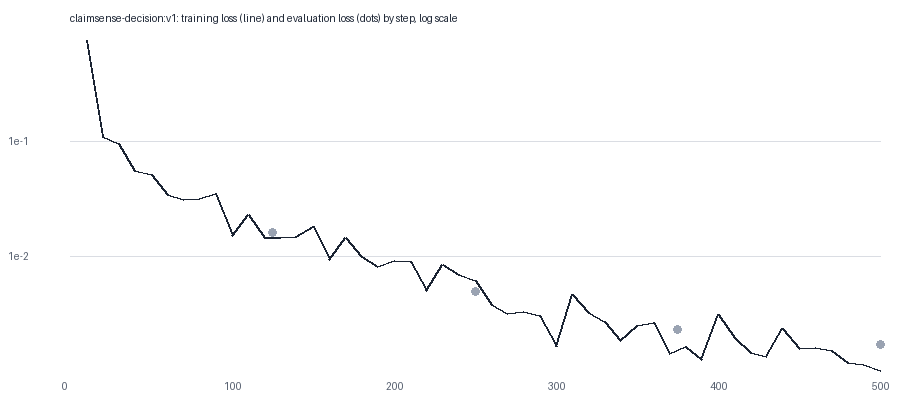
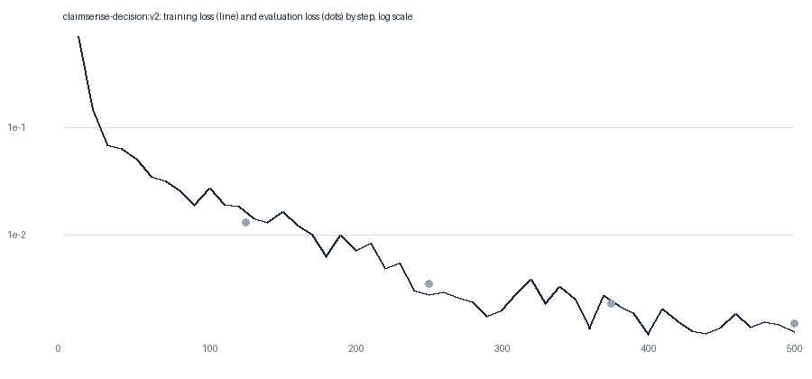
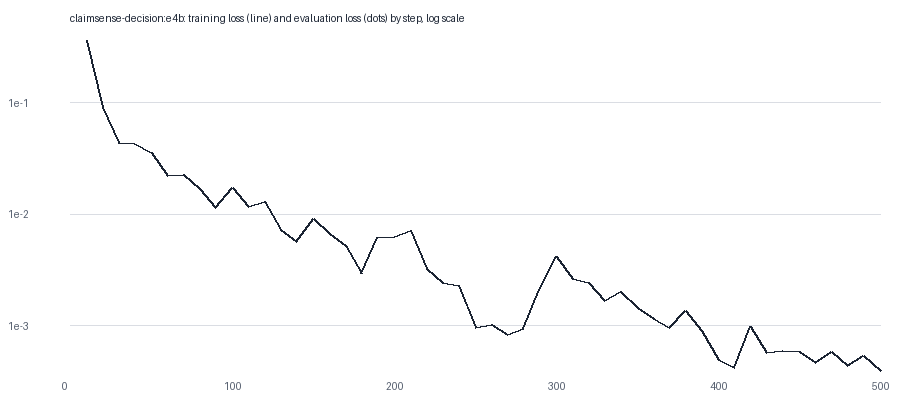

# Training: models v1, v2 and E4B

Generated by `scripts/verify/training_report.py` from each Kaggle run's
training-log.json, config.json and lengths.json; do not edit by hand. All runs: QLoRA
with Unsloth on one Kaggle T4, 4-bit base model, sequences up to 3,072 tokens, seed
20260921, loss on the responses only. E4B trained without evaluations (they ran out of
T4 memory, D-TRAIN-2).

| | claimsense-decision:v1 | claimsense-decision:v2 | claimsense-decision:e4b |
|---|---|---|---|
| Data | decision dataset v1, prompt decision_v2 | decision dataset v2, prompt decision_v3 | decision dataset v2, prompt decision_v3 |
| Base model | unsloth/gemma-4-E2B-it | unsloth/gemma-4-E2B-it | unsloth/gemma-4-E4B-it |
| Training records | 2000 | 2000 | 2000 |
| Validation records | 300 | 300 | 300 |
| LoRA | r 16, alpha 16, dropout 0.0 | r 16, alpha 16, dropout 0.0 | r 16, alpha 16, dropout 0.0 |
| Optimizer | adamw_8bit, learning rate 0.0002, linear | adamw_8bit, learning rate 0.0002, linear | adamw_8bit, learning rate 0.0002, linear |
| Batch | 1 x 8 accumulation | 1 x 8 accumulation | 1 x 8 accumulation |
| Epochs | 2 | 2 | 2 |
| Steps | 500 | 500 | 500 |
| GPU | Tesla T4 | Tesla T4 | Tesla T4 |
| Precision | float32 | float32 | float32 |
| Run time (training) | 3.04 h (10,934 s) | 4.22 h (15,209 s) | 7.15 h (25,749 s) |
| Seconds per step | 21.9 | 30.4 | 51.5 |
| Mean training loss | 0.028778 | 0.027574 | 0.015717 |
| Final logged training loss | 0.001026 | 0.001254 | 0.000403 |
| Evaluations during training | 4 | 4 | 0 |
| Best evaluation loss | 0.001711 | 0.001491 | not logged |

